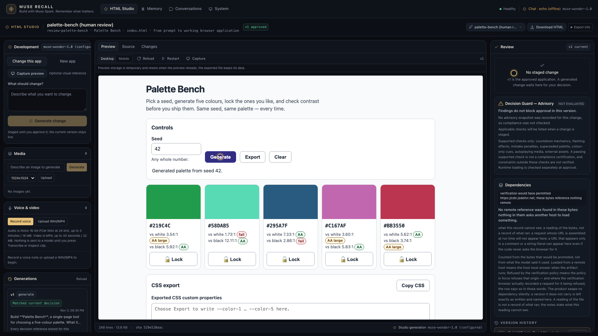
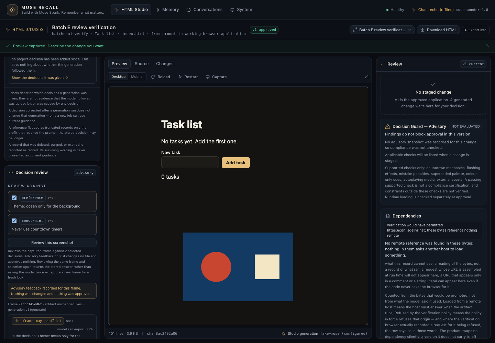
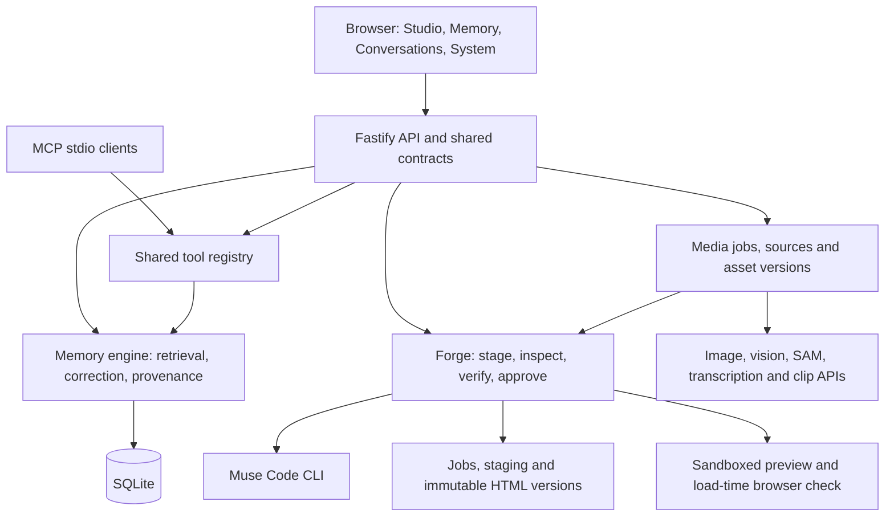

# Muse Recall

### The memory your project keeps.

The first version is only the beginning. Next week, your AI builder needs to remember why you chose that layout, which accessibility rules matter, and what changed when you corrected the brief.

**Muse Recall is a local-first studio for building small browser applications with project memory you can inspect and correct.** Record decisions, bring in images or other references, generate with Muse, and review each proposed change before publishing it. Keep the application, its versions, and the decisions supplied to each generation together.

**Remember the brief. Bring the references. Review the change. Keep control.**

[Quick start](#quick-start) · [Demo](#see-the-workflow) · [Beta capabilities](#what-the-beta-can-do) · [Architecture](#architecture) · [Evidence](#what-is-verified) · [Limitations](#limitations)

> **v0.1.0 beta.** A local-first, single-user studio, with correctable memory, media references and staged application review. [Download the release](https://github.com/sidonsoft/muse-recall/releases/tag/v0.1.0) · [Beta release notes](docs/release/notes/v0.1.0-beta.md).

## See the workflow



*Current beta UI displaying Palette Bench, a retained live Muse Wonder generation. Captured from a disposable replay of the saved project; no new model call. This application still has documented review findings, discussed below.*

**The useful moment is when the next request conflicts with something the project already decided.** Recall supplies active decisions to the generation. Decision Guard can expose supported source-pattern conflicts. You inspect the result and decide whether it becomes the current version.

[Watch the beta demo — 3:00](https://github.com/sidonsoft/muse-recall/blob/main/docs/demo/video/Muse_Recall_Demo_V21_1080p.mp4?raw=true) · [Transcript](docs/demo/video/Muse_Recall_Demo_V21_Transcript.txt) · [Project website](https://sidonsoft.github.io/muse-recall/)

The three-minute demo brings together retained live correction footage, the expanded beta UI, real provider-returned media and clearly labelled test fixtures. The palette sequence preserves a real failure: the model reintroduced an old decision, and the successful version required an explicit request to follow current decisions. A corrected memory changes future context; it does not automatically rewrite an application or guarantee compliance. [Recording scope and file verification](docs/demo/video/V21_QA.md).

## What the beta can do

### Keep decisions useful as the project changes

- **Remember across sessions.** Store project constraints, preferences and decisions with provenance and history. Retrieval supplies a bounded selection of active records to later work.
- **Correct without losing the reason.** Supersede an outdated decision with a replacement. The old record remains auditable and leaves active retrieval.
- **See what a generation received.** Inspect the decision references and revisions supplied to a job. Later edits are distinguishable from what that job actually saw.
- **Review and trace memory.** Use the review queue, timeline and relationship map. Move memory between installs with versioned export/import, including history and supersession links.

### Build with references, images, voice and video

- **Images:** upload, generate or edit image assets; review candidate versions; approve and insert them into an application request. Approved image references are embedded into the published HTML with integrity records.
- **Reference images:** propose decision drafts for your confirmation, or select an object and extract a transparent cutout with SAM. Inserting a reference prepares a request; starting the coding job remains a separate action.
- **Voice and video:** record or upload sources, play them back, download them, transcribe speech and request observations about a video clip. These are reference workflows, not audio or video generation.
- **Screenshot review:** capture the preview and ask a vision model to compare the frame against selected decision revisions. Findings are advisory: review alone changes no application, publishes no version and writes no memory.

| Generate an image | Edit the same asset |
| --- | --- |
|  |  |

*Actual provider-returned images from the 2 November generate/edit check. They demonstrate one successful asset workflow, not a general quality benchmark. [Live capability evidence and scope](docs/MULTIMODAL_STUDIO_STATUS.md).*

### Make every application change reviewable

Forge, the generation workflow behind HTML Studio, produces one `index.html` with inline CSS and JavaScript. Review **Preview**, **Source** and **Changes** before approval.

- **Stage before publishing.** A proposal waits for your decision; rejection leaves the approved version unchanged.
- **Check the bytes being approved.** Syntax/structure validation and a load-time browser check precede promotion. Approval publishes the exact prepared bytes checked by that process, including resolved assets and bundled dependencies.
- **Understand dependencies.** The approval panel distinguishes bundled code, remote references and requests blocked during verification. The pinned supported Phaser engine is bundled; older or other references can still require the network. Disclosure reads source bytes and cannot enumerate every dynamically constructed request.
- **Keep versions recoverable.** Inspect history and restore a recorded parent version. Copy source and Download HTML hand over the served artifact bytes. Restart recovery reports interrupted or damaged jobs rather than hiding them.
- **Read Guard as evidence.** Seven supported source-pattern families cover countdowns, flashing effects, mistake penalties, superseded palettes, colour-only cues, autoplaying media and external assets. Findings never block approval. Unsupported constraints remain unverified.



*Real beta UI from the deterministic screenshot-review browser test. The application and review response are fixtures; this screenshot demonstrates the interface and its boundaries, not live model judgement.*

### Connect other tools and look after your data

A shared seven-tool contract is available through the application and an MCP stdio server. The REST API also exposes memory traversal, a machine-readable error catalogue and idempotent replay on supported writes. MCP starts read-only; enabling writes at startup authorizes writes for that process, without a per-write review dialog.

Database and media backup/restore tools, restore drills, health alerts, recovery summaries and a damaged-state inspect/repair path support longer-running local use. Memory export/import is portability, not a complete backup of application files and media. See the [operator runbooks](docs/ops/OPERATOR_RUNBOOKS.md).

## Quick start

### Get the beta

```bash
git clone --branch v0.1.0 https://github.com/sidonsoft/muse-recall.git
cd muse-recall
```

The [Codespaces walkthrough](.devcontainer/README.md) offers a browser-based setup for browsing. Real application generation still needs a configured coding CLI. Its setup includes an anonymous launch counter, with an opt-out documented there.

### Browse without a Muse account

You need **Node.js 24+** and **pnpm 10.x**; the workspace pins pnpm `10.32.1`. From the selected checkout:

```bash
pnpm install --frozen-lockfile
pnpm demo:seed
MODEL_PROVIDER=echo pnpm dev
```

Open [http://127.0.0.1:5173](http://127.0.0.1:5173); the API runs on `127.0.0.1:8787`. Open `forge-demo` to inspect a recorded game, project decisions, a superseded palette and version history. No provider credential is needed for this browsing path.

Run the seed before starting the server. Re-running it resets the `forge-demo` workspace to its recorded version 1. **`echo` powers offline chat and browsing; it does not generate Studio applications.**

### Generate and approve a real application

Real generation requires a working **Muse Code CLI** on your machine, logged in, plus a browser for approval checks:

```bash
muse --version
muse login
pnpm exec playwright-core install chromium
MODEL_PROVIDER=muse-cli pnpm dev
```

1. Create a project and add a decision, for example: “No countdown timers or flashing effects.”
2. Describe a small application and generate it. Wait for the staged proposal.
3. Inspect the preview, source, diff, memory references, Guard findings and dependencies.
4. Approve to publish a version, or reject to leave the current version unchanged.
5. Request a change. If a project decision changes, correct the memory and explicitly request the corresponding application change.

For settings, copy `.env.example` to `.env` once and edit it. `FORGE_MUSE_BIN` selects the Studio CLI; `FORGE_MUSE_MODEL` selects its coding model. The default chat model is `muse-wonder-1.0`; do not assume every surface uses Spark. The UI distinguishes configured identity from reported execution identity when available.

Image generation/editing, segmentation, transcription, clip observation and screenshot review use the media API and require a server-side `FORGE_MUSE_API_KEY`; a CLI login alone does not configure these paths. Provider operations can incur charges and quota limits. See [configuration](.env.example), [getting started](docs/guide/getting-started.md) and [multimodal status](docs/MULTIMODAL_STUDIO_STATUS.md).

## Architecture



React renders the workspace. Fastify owns state and validates shared contracts. SQLite stores memories, sessions and audit history; the workspace filesystem stores Forge jobs, versions and media. MCP uses the same memory engine and tool registry, rather than a separate memory store.

Retrieved text is bounded reference data, not permission to execute tools. Generated HTML runs in an opaque-origin sandboxed preview. The coding CLI runs as the server's local user under its own policy controls; the application does not provide a container or OS isolation boundary. Downloaded HTML runs outside the Studio sandbox.

Local-first means state stays on your machine. It does **not** mean live inference stays offline: selected prompts, images, audio, video or frames are sent to the configured provider when those features run. [Architecture details](docs/ARCHITECTURE_OVERVIEW.md) · [Security](docs/security.md).

## What is verified

**Memory changed generated source in a bounded experiment.** Phase 17 retained 480 pre-registered runs across two models and six fixed strata. Original-rule violations among usable runs were:

| Condition | Muse Spark | Muse Spark Open |
| --- | ---: | ---: |
| No project memory | 37/57 | 49/60 |
| Retrieved project memory | **0/58** | **1/60** |
| Same rule retyped manually | 0/58 | 0/60 |

Eight Spark runs hit the time cap; none did on Spark Open. The result supports supplying relevant memory rather than repeatedly retyping a rule. It measures source patterns in fixed tasks, not runtime safety, Guard effectiveness, general application quality or the newer multimodal features. The correction arm released an old restriction; it did not test compliance with a replacement requirement. Spark Open was a research provider, not a selectable application provider. [Results](docs/hackathon-evidence/phase17/RESULTS.md) · [Statistical reporting correction](docs/hackathon-evidence/phase17/STATS_CORRECTION.md).

**The beta workflow has separate engineering evidence.** Ten offline release gates check production bundles: approval/version workflows, runtime and origin controls, media persistence/playback, screenshot-review boundaries, artifact probes and byte-checked copy/download. Fixture coding and model responses prove the workflow; they do not establish generated-app quality. The [v0.1.0 release](https://github.com/sidonsoft/muse-recall/releases/tag/v0.1.0) carries the final gate report and source archive, with the tested commit and bundle hashes. Separate live records demonstrate image/edit, cutout-to-application, transcription, clip observation and one screenshot review on a known frame. [Gate scope](docs/beta/RELEASE-GATE.md) · [Live evidence](docs/MULTIMODAL_STUDIO_STATUS.md).

To check the selected checkout:

```bash
pnpm verify                  # lint, product/test typechecks, unit/integration tests
pnpm verify:research17       # retained research records; also needs python3
pnpm build
pnpm verify:release-gate     # offline production workflow gates
```

The release gate builds and checks production bundles and records their identity. It refuses exported provider credentials; use its reported prerequisite instructions if blocked. A retained pass applies to its recorded commit and bytes, not automatically to a later checkout. Human acceptance remains a separate decision.

## Limitations

- **Single-user beta.** Loopback is the default. An optional shared bearer token can gate API access, except the open health endpoint; it provides no accounts, per-user permissions or hosted collaboration.
- **One HTML application.** No general multi-file project generation or deployment pipeline. Dependencies outside the supported bundled engine may still require network access.
- **Memory is fallible.** Keyword retrieval has vocabulary and budget limits. Supplied context does not guarantee compliance or automatic token savings. Deletion has no API undo.
- **Approval checks loading, not correctness.** It does not exercise every interaction, verify accessibility, judge design or prove an application safe. Preview storage is temporary; exported HTML has different execution and storage conditions.
- **Both review paths are advisory.** Source-pattern Guard and model-based screenshot review have different coverage; neither is a compliance certificate. One frame cannot establish dynamic behaviour.
- **Generated applications still need human judgement.** The retained Palette Bench review has four open application findings, including stale output and session-scoped undo. Platform gates passing does not make those application defects disappear. The retained application-quality judgement sheet remains unscored; publication is not a quality score for generated output.
- **Single-process persistence.** Interrupted jobs are reported, not resumed. In-flight locks are local to one process; idempotency does not provide a distributed one-paid-call guarantee.
- **Provider access is bounded.** Credentials, model availability, quota, latency and cost affect live features. Vision-derived decision drafts are experimental; their advantage over asking the coding model directly has not been established.

[Full limitations](docs/guide/limitations.md) · [Known issues](docs/KNOWN_ISSUES.md) · [Beta release notes](docs/beta/RELEASE-NOTES.md)

## Learn more

[User guide](docs/guide/README.md) · [Project memory](docs/guide/project-memory.md) · [HTML Studio](docs/guide/html-studio.md) · [Operations](docs/ops/OPERATOR_RUNBOOKS.md) · [Research records](docs/hackathon-evidence/phase17/RESULTS.md)

## License

MIT. See [LICENSE](LICENSE).
