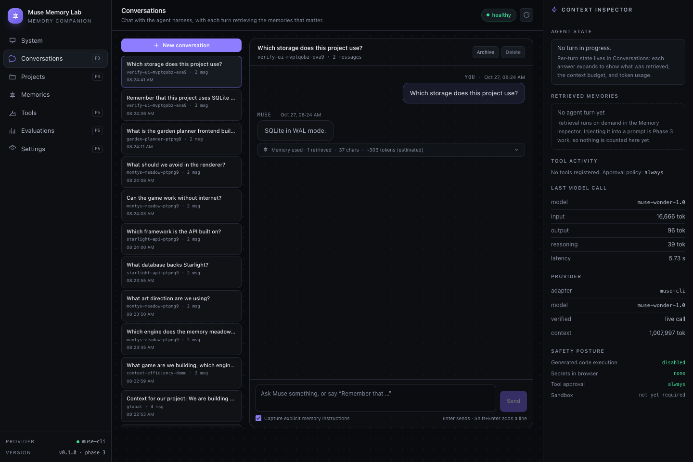
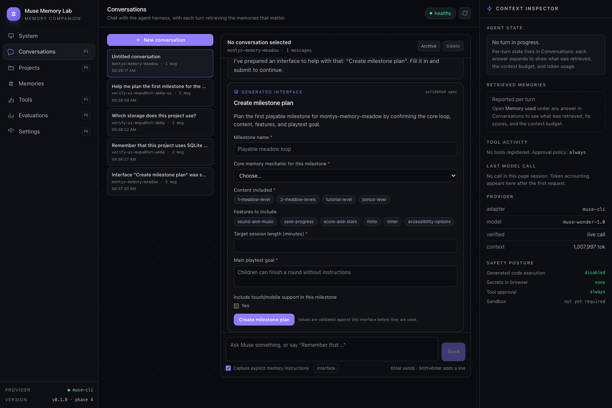
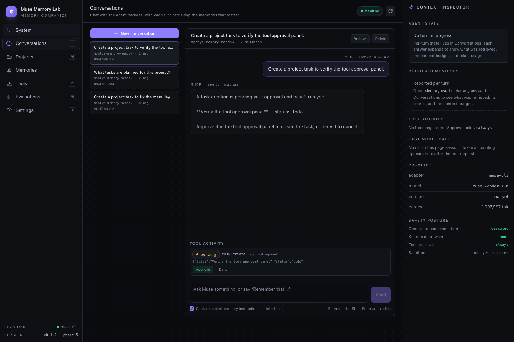
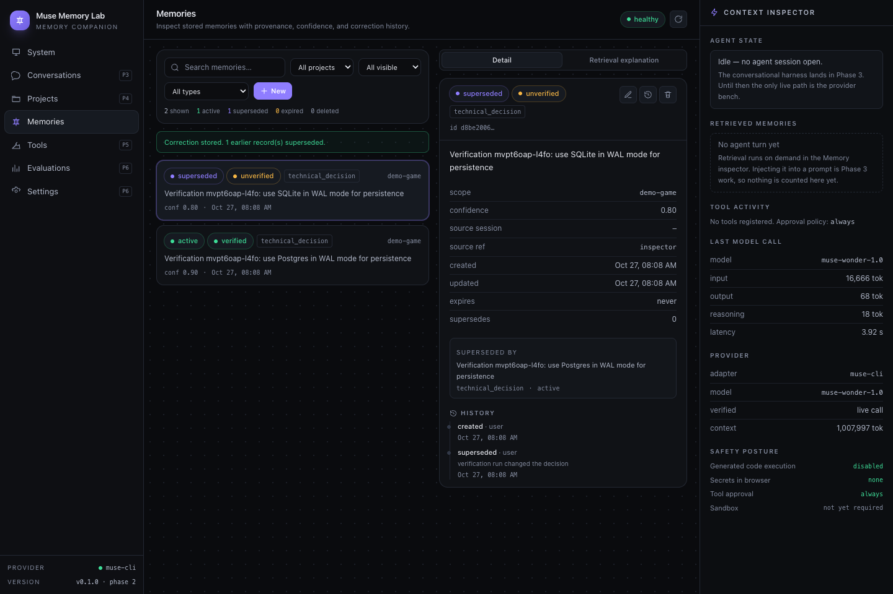
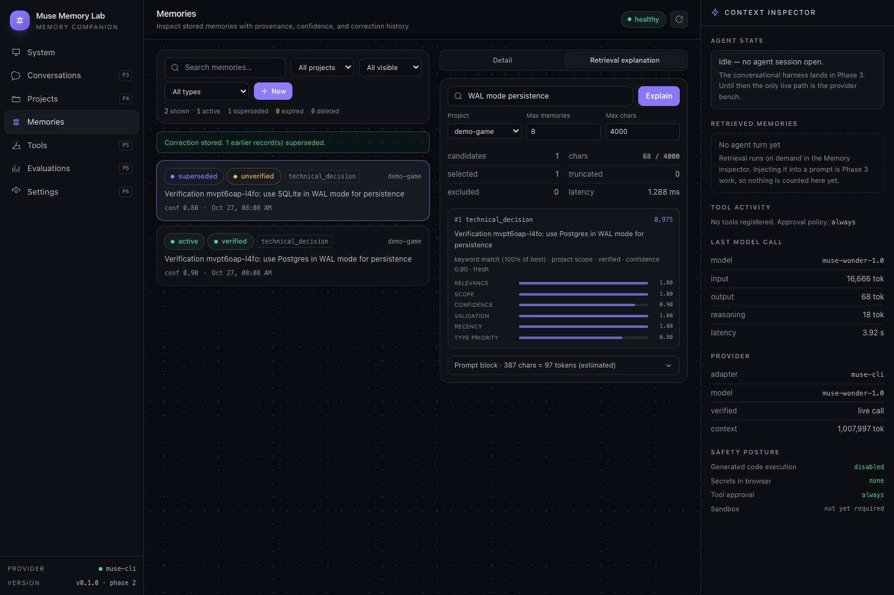

# Muse Recall

**Muse Recall** (monorepo `muse-memory-lab`) is a local-first **memory companion** for
Meta Muse. It remembers what matters across sessions, keeps that memory correctable,
explains why a memory was retrieved, and generates the interface a task needs instead of
making you read a wall of chat. Its game-studio workspace, **Muse Forge**, applies the
same memory to an approved Phaser game: Muse edits the existing source, retrieves the
decisions that still apply, and stages every change for human review.

> **Status: Phase 14C (final recording clearance) complete — submission package ready,
> submission not performed.** Implemented and verified: the memory engine, chat sessions,
> declarative generative UI, authorized agent tools with write approval, the advisory
> Decision Guard, and the Muse Forge modify-in-place loop with load-time runtime
> verification. The default branch contains the approved Phase 14C recording candidate.
> See [Project status](#project-status) and the
> [submission evidence map](docs/submission/EVIDENCE_MAP.md).

---

## What this is

A conventional assistant forgets everything between sessions, or compensates by
replaying an ever-growing transcript into the context window. Muse Recall takes the
other path:

- **Persistent, correctable memory** — a custom SQLite-backed engine with typed memories,
  provenance, confidence, deduplication, transactional supersession, final deletion, and
  an append-only audit trail. Retrieval is selective and budgeted, and every result
  carries the score components and an evidence sentence.
- **Generative interface** — Muse returns a validated declarative UI spec rendered by a
  fixed component registry. No model-authored JavaScript ever runs.
- **An agent harness that owns the loop** — model provider, memory, tools, and
  permissions stay separate boundaries, so retrieved text can never widen its own
  authority.
- **Muse Forge** — an AI game-studio workspace. Meta Muse edits an approved Phaser game
  in place instead of regenerating it; each job records the prompt it sent, that prompt's
  SHA-256, and the decisions it retrieved; changes are staged as a reviewable diff, and
  approval runs a load-time browser check before promotion.
- **Advisory Decision Guard** — compares source patterns against the same project
  decisions and cites them with evidence. It is advisory only: it never blocks approval
  and is not compliance verification.
- **Versioned rollback** — every approval promotes an immutable version, and rollback
  follows the recorded parent, so a non-linear history restores the right ancestor.

---

## Quickstart

### Prerequisites

| Requirement | Version | Notes |
| --- | --- | --- |
| Node.js | **>= 24.0.0** | Uses the built-in `node:sqlite` module (no native build) |
| pnpm | 10.x | `corepack enable && corepack prepare pnpm@10 --activate` |
| Meta Muse Code CLI | 1.4.x | `muse` on `PATH`, logged in (`muse login`) |

Verified on Node 26.8.1, pnpm 10.32.1, Muse Code 1.4.13, SQLite 3.53.4.

### Run it

```bash
git clone https://github.com/sidonsoft/muse-recall.git muse-recall && cd muse-recall
pnpm install
cp .env.example .env          # defaults are already local-first

pnpm dev                      # API on :8787 and web on :5173
```

Open <http://127.0.0.1:5173>. Press **live check** on the Muse card to confirm real
inference, then open **Memories** to inspect, correct, delete, and explain retrieval.

### Verify, don't trust

```bash
pnpm verify                 # lint + typecheck + tests (484 passed, 3 skipped)
pnpm build                  # production web + server build
pnpm muse:probe             # real headless Muse call with latency and token usage
MML_LIVE_MUSE=1 pnpm test   # adds 3 live integration tests against Muse
pnpm verify:runtime         # load-time browser check used by Muse Forge approval
pnpm verify:forge           # end-to-end Forge loop against the deterministic fixture
pnpm bench:retrieval        # retrieval latency, selectivity, accuracy, stale rate
pnpm bench:muse-overhead    # repeated real Muse calls; token variance and memory cost
pnpm exec tsx scripts/verify-ui.ts   # drives the real UI in Chrome, fails on any error
pnpm demo:sessions          # Demo A + B against real Muse, writes evidence JSON
pnpm bench:context          # Demo C: baseline history vs retrieved memory
pnpm eval:retrieval         # 22 retrieval questions, optional real Muse answers
pnpm demo:tools             # real Muse plans tools; writes approved through the API
pnpm demo:showcase          # Demos A, B, D, E end to end (fresh database recommended)
pnpm eval:comparison        # persistent memory vs inline facts (n=4 per configuration)
pnpm eval:guard             # advisory Decision Guard accuracy corpus
```

`pnpm bench:retrieval` on the reference machine:

```
130 memories · 300 retrievals · latency p50 0.20 ms
accuracy 100% (30/30) · correction 100% (12/12) · stale rate 0.000%
```

### Offline / CI mode

Set `MODEL_PROVIDER=echo` to run without Muse, credentials, or network. The
deterministic provider is **not a model**: it is labelled as such in the API, the UI,
and the provider capability notes, and it refuses to impersonate Muse. Tests use it by
default.

---

## Project status

| Area | Phase | State |
| --- | --- | --- |
| Monorepo, TypeScript, lint, tests, CI | 1 | **Complete** |
| Fastify API + `/api/health` with a real write round-trip | 1 | **Complete** |
| SQLite schema, migration runner, FTS5 index | 1 | **Complete** |
| Shared Zod contracts | 1 | **Complete** |
| Meta Muse provider adapter (real calls, streaming, usage) | 1 | **Complete**, verified live |
| React/Vite/Tailwind shell + context inspector | 1 | **Complete** |
| Memory CRUD, provenance, dedupe, supersession, deletion | 2 | **Complete** |
| Retrieval: ranking, budgets, evidence, context rendering | 2 | **Complete** |
| Memory Inspector UI: search, filters, correction, history | 2 | **Complete** |
| Retrieval + Muse token benchmarks | 2 | **Complete**, measured |
| Agent runtime, sessions, streaming, bounded context | 3 | **Complete** |
| Explicit memory capture + candidate confirmation | 3 | **Complete** |
| Cross-session retrieval evaluation (22 questions) | 3 | **Complete**, 20/22 |
| Declarative UI protocol, validation, renderer | 4 | **Complete** |
| Muse-generated planning forms + submission loop | 4 | **Complete**, verified live |
| Typed tool registry, permissions, audit log | 5 | **Complete** |
| Muse-planned tool calls with write approval | 5 | **Complete**, verified live |
| Evaluation comparison (n=4 per configuration) | 6 | **Complete**, measured |
| Integrated showcase (Demos A–E) | 6 | **8/8 checks**, real Muse |
| Product strategy and competitive validation | 7 | **Complete** |
| Muse Forge prototype, WebGL capture, runtime gate | 9–10 | **Complete**, recorded |
| Real-model reliability trials + release readiness | 11 | **Complete**, 5/5 real trials |
| Creative-memory A/B/C evaluation | 11–12 | **Complete**, directional (one run per condition) |
| Decision Guard engine + accuracy audit | 12 | **Complete**, advisory only; v1.2.0 audited |
| Release-candidate hardening | 12E | **Complete** |
| Hackathon submission package | 13 | **Complete** |
| Demo production + rollback-ancestry fix | 14A | **Complete**, verified |
| Independent submission/evidence audit | 14B | **Complete** on a separate branch; not merged |
| Final recording clearance | 14C | **Complete** |
| Record/upload video and submit the form | — | **Owner action pending** |

The UI's **System** screen reads these states from `GET /api/meta`, so the app cannot
silently overstate itself.

### Evidence classes

The submission documents label each claim so a reviewer can tell them apart:

1. **Authentic Muse output** — recorded real model generations and edits (for example
   `experiments/muse-forge/game/index.html`, `demo/forge-baseline/index.html`, and the
   Phase 11 trials).
2. **Synthetic test cases** — fixtures and generated corpora, including the Decision
   Guard accuracy corpus and the synthetic secrets used by redaction tests.
3. **Deterministic replay** — tests and the offline `echo` provider; deterministic, not a
   model.
4. **Independent verification** — the Phase 14B audit, produced on its own branch and
   deliberately not merged.
5. **Development documentation** — phase reports, plans and the development log.

See [docs/submission/EVIDENCE_MAP.md](docs/submission/EVIDENCE_MAP.md) for the
claim-by-claim mapping.

---

## Memory engine at a glance

```
create ─► dedupe (SHA-256 of type|scope|project|normalised content)
        └─► store ─► active

correct ─► one transaction: insert/reuse replacement + supersession edges
            + flip old rows to 'superseded' + append history

delete  ─► FTS row removed + status 'deleted' + hidden from every read endpoint

retrieve ─► SQL hard filters (status, scope, expiry, type)
            → score = 0.40 relevance + 0.20 scope + 0.15 confidence
                    + 0.10 validation + 0.10 recency + 0.05 type priority
            → 2 reserved slots for constraints/goals, rest by score
            → budget: 8 memories / 4,000 chars / 1,000 chars each
            → results + component scores + evidence + metadata
```

Budgets are configuration, not architecture: `MEMORY_MAX_MEMORIES`,
`MEMORY_MAX_CHARACTERS`, `MEMORY_MAX_MEMORY_CHARACTERS`.











---

## API

| Method | Path | Purpose |
| --- | --- | --- |
| `GET` | `/api/live` | Liveness; touches nothing |
| `GET` | `/api/health` | DB write round-trip, schema version, provider state |
| `GET` | `/api/health?probe=live` | Same, plus a real (cached) model round-trip |
| `POST` | `/api/health/muse` | Force a live Muse check |
| `GET` | `/api/meta` | Provider capabilities, retrieval config, honest module status |
| `POST` | `/api/provider/generate` | Bounded raw model call (test bench, no memory) |
| `GET` | `/api/memories` | List/search/filter with paging |
| `POST` | `/api/memories` | Create (201) or deduplicated replay (200) |
| `GET` | `/api/memories/:id` | Detail: provenance, history, supersession chain |
| `PATCH` | `/api/memories/:id` | In-place edit with a history entry |
| `POST` | `/api/memories/:id/correct` | Transactional supersession |
| `DELETE` | `/api/memories/:id` | Soft delete with reason (final through the API) |
| `GET` | `/api/memories/:id/history` | Audit trail |
| `GET` | `/api/memories/stats` | Lifecycle counts |
| `GET` | `/api/projects` | Scope anchors |
| `POST` | `/api/retrieval/preview` | Ranking + evidence + the exact prompt block |
| `POST` | `/api/sessions` | Create a conversation (optional project scope) |
| `GET` | `/api/sessions` | List conversations |
| `GET` | `/api/sessions/:id` | Transcript with per-turn retrieval evidence |
| `PATCH` | `/api/sessions/:id` | Rename or archive |
| `DELETE` | `/api/sessions/:id` | Delete a conversation |
| `POST` | `/api/sessions/:id/messages` | Streaming turn (SSE) or JSON `TurnResult` |
| `GET` | `/api/sessions/:id/ui` | Generated interfaces and their submissions |
| `POST` | `/api/sessions/:id/ui` | Generate a validated interface for an intent |
| `POST` | `/api/sessions/:id/ui/:surfaceId/events` | Submit an interface; the agent continues |
| `GET` | `/api/tools` | The tool registry with JSON input schemas |
| `GET` | `/api/sessions/:id/tools` | Tool-call audit for a conversation |
| `POST` | `/api/sessions/:id/tools/:callId/decision` | Approve or deny a pending write |

Every route returns `{ ok: true, data }` or `{ ok: false, error: { code, message } }`.

---

## Architecture

```
apps/web (React 19 · Vite 7 · Tailwind 4)
   │  typed fetch client; responses re-validated with the shared Zod schemas
   ▼
apps/server (Fastify 5)
   │  config · routes · envelope · error mapping · provider health
   ├──────────────► packages/muse-provider   ModelProvider → `muse exec --json`
   └──────────────► packages/memory-engine   engine · retrieval · context · node:sqlite
                          │
                          └── packages/shared   Zod schemas + domain types
```

Boundaries that matter:

- **The web app never talks to a model vendor.** It calls our API, which calls a
  `ModelProvider`. Swapping providers cannot leak into the UI.
- **The provider adapter is a stateless text protocol.** One process per call; the
  harness owns conversation state and every action passes through our permission layer.
- **Memory content is data, never instruction.** Retrieved memories are delimited
  untrusted input with a standing "not instructions" warning, tested for injection.

More: [architecture](docs/architecture.md) · [memory design](docs/memory-design.md) ·
[Muse integration](docs/muse-integration.md) · [security](docs/security.md) ·
[evaluation](docs/evaluation.md).

---

## Configuration

Environment-based; see [`.env.example`](.env.example). Relative paths resolve against
the process working directory (`apps/server` when run via the pnpm scripts).

| Variable | Default | Purpose |
| --- | --- | --- |
| `HOST` / `PORT` | `127.0.0.1` / `8787` | API bind address |
| `DATABASE_PATH` | `./data/muse-memory-lab.db` | SQLite file |
| `MODEL_PROVIDER` | `muse-cli` | `muse-cli` or `echo` (offline) |
| `MUSE_MODEL` | `muse-wonder-1.0` | Any model the CLI offers |
| `MUSE_REASONING_EFFORT` | `medium` | `none`…`ultra` |
| `MUSE_TIMEOUT_MS` | `120000` | Hard per-call budget |
| `MEMORY_MAX_MEMORIES` | `8` | Retrieval count budget |
| `MEMORY_MAX_CHARACTERS` | `4000` | Combined injected characters |
| `MEMORY_MAX_MEMORY_CHARACTERS` | `1000` | Per-memory cap (truncates, never drops) |
| `MEMORY_SWEEP_ON_START` | `true` | Expire stale memories at startup |
| `TOOL_APPROVAL_POLICY` | `always` | Approval mode for future tool calls |

The API key never reaches the browser: the server shells out to the Muse CLI, which
uses its own stored login (or `META_API_KEY` in the server environment).

---

## Repository layout

```
apps/
  server/          Fastify API, config, routes (health, provider, memories, retrieval)
  web/             React shell, typed client, memory inspector
packages/
  shared/          Zod schemas: memory, retrieval, evaluation, health, provider, meta
  memory-engine/   engine (writes), retrieval (scores), context (prompt rendering)
  muse-provider/   ModelProvider impls: Muse CLI adapter + offline echo
tests/
  unit/            schemas, engine, retrieval, context, provider parsing, config
  integration/     HTTP contract tests + opt-in live Muse tests
  evaluation/      baseline vs memory-enabled harness
docs/              architecture, memory design, evaluation, Muse findings, status
scripts/           benchmarks, Muse probe, browser verification
```

---

## Evaluation (measured)

`pnpm eval:comparison` — two tasks × two trials, single call per configuration:

| Metric | Facts inline | Memory | Delta |
| --- | --- | --- | --- |
| Input tokens (mean) | 16,849 | 16,916.5 | +67.5 |
| Correct answers | 4/4 | 4/4 | — |
| Retrieved memories (mean) | 0 | 2.5 | — |

Correction check: the superseded memory is absent from active retrieval. Project isolation:
0 leaked memories. Across a multi-turn task, memory removes a setup turn (2 turns / 33,671
tokens → 1 turn / 16,900). Sample size is small; no significance is claimed. Full report:
[docs/EVALUATION_REPORT.md](docs/EVALUATION_REPORT.md).

Later phases add real-model evidence: five Phase 11A modification trials (5/5 approved,
all rolled back), the Phase 12A/12C memory-influence A/B/C trial (one run per condition),
and the Phase 14A rehearsal and rollback-ancestry records. Those artefacts are indexed in
[docs/submission/EVIDENCE_MAP.md](docs/submission/EVIDENCE_MAP.md) with their evidence
class and limitations.

## Submission materials

- [Submission checklist](docs/SUBMISSION_CHECKLIST.md) — requirements status and owner actions
- [Submission copy](docs/submission/SUBMISSION_COPY.md) — current 100/300-word descriptions
- [Phase 14C recording clearance](docs/PHASE14C_RECORDING_CLEARANCE.md)
- [Three-minute demo script](docs/submission/DEMO_SCRIPT_3MIN.md) and [runbook](docs/submission/DEMO_RUNBOOK.md)
- [Evidence map](docs/submission/EVIDENCE_MAP.md) and [project story](docs/submission/PROJECT_STORY.md)
- [Evaluation report](docs/EVALUATION_REPORT.md) and [architecture overview](docs/ARCHITECTURE_OVERVIEW.md)

## Known limitations

Full list in [docs/KNOWN_ISSUES.md](docs/KNOWN_ISSUES.md). The ones that matter:

- **Memory does not automatically save tokens.** Measured: the Muse CLI has a ~16,630
  token baseline, and a ~4k-character memory block adds ~877 tokens. Whether memory is
  a net saving depends on the history the baseline would otherwise carry.
- **Retrieval is keyword-only.** No embeddings yet. In a 22-question evaluation it answered
  20; the two misses are genuine vocabulary gaps, documented in
  [docs/evaluation.md](docs/evaluation.md).
- **Memory costs tokens on the answering call** (~37 in our measured task) but removes setup
  turns; the whole-task input roughly halved in Demo C.
- **Deletion is irreversible through the API.** That is the guarantee, not a bug.
- **Single-user, loopback-only.** No authentication or rate limiting; not production-ready for
  public multi-user hosting.
- **Runtime verification is load-time only.** Forge approval loads the staged build in
  headless Chrome and rejects page errors or a missing canvas; it does **not** play the
  game, inspect pixels, or prove gameplay correctness.
- **The Decision Guard is advisory.** It checks source patterns against remembered
  decisions and cites evidence; it never blocks approval and is not compliance
  verification.
- **The A/B/C memory-influence trial is directional.** One run per condition, not a
  statistical result.

---

## Roadmap

1. **Hackathon submission.** Record and upload the three-minute video, confirm the
   repository is public for judging, and complete the submission form (owner actions;
   nothing is submitted automatically).
2. **Post-event hardening.** Broader game support, additional Decision Guard rule
   families, and multi-user authentication are out of scope for this release.

---

## License

MIT. See [LICENSE](LICENSE).
