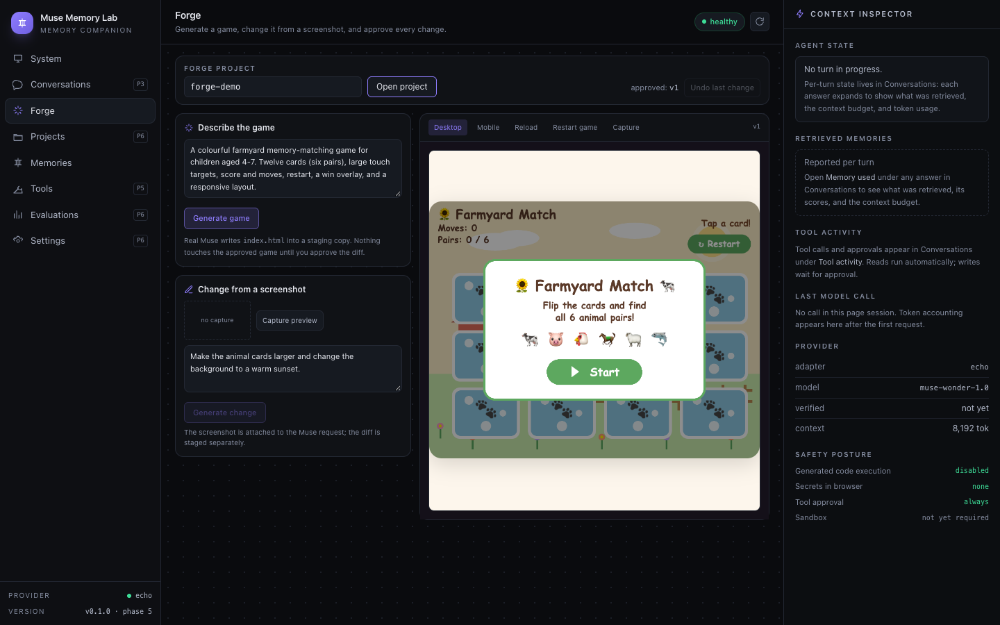
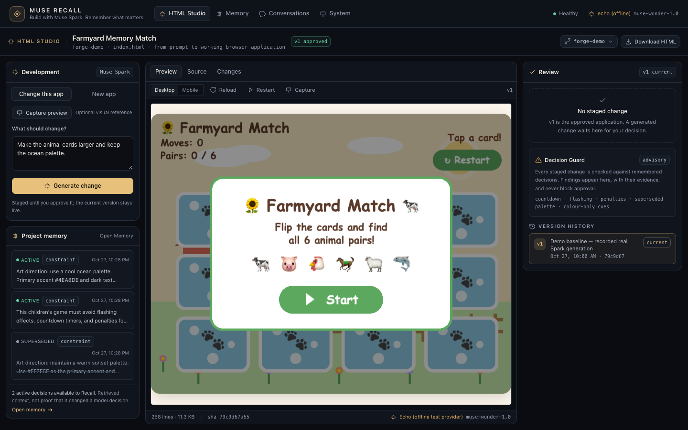
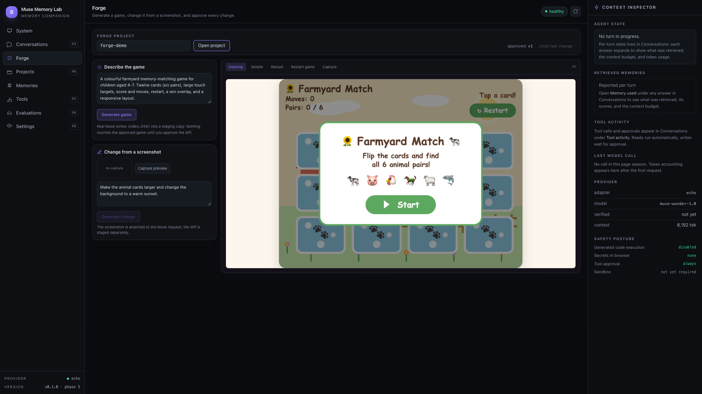
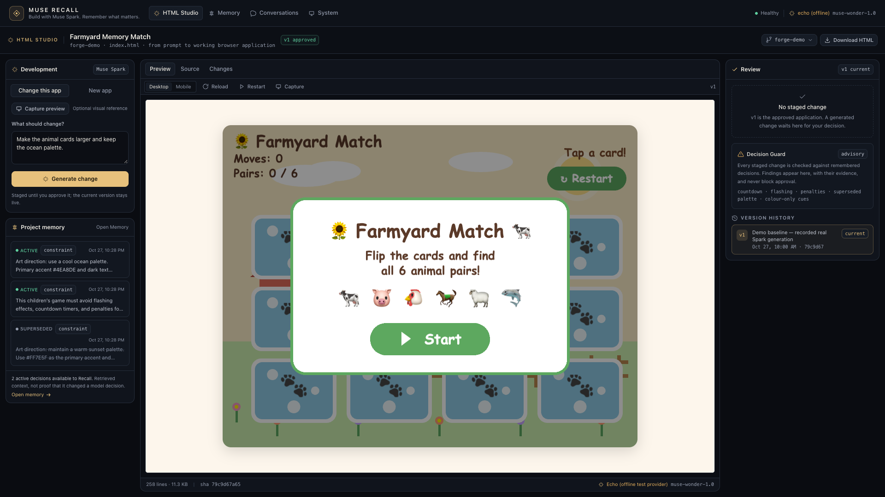
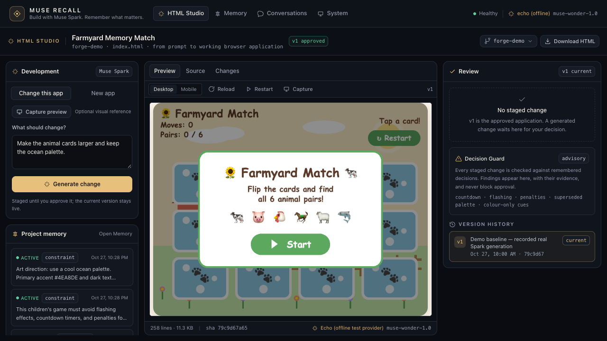

# Muse Recall — UX audit

**Audited baseline:** `main` at `e6e2f86928f35565ccfb54ea8d33e1af1177bd6e` (the last approved
public-release baseline), read through the candidate worktree before any change.

**Candidate:** `agent/muse-recall-product-positioning`.

**Method:** source inspection plus real browser interaction with Playwright/Chrome against a
seeded `forge-demo` project and the deterministic offline provider. Screenshots at 1920×1080,
1440×900 and 1280×720. The retained modification/review evidence was produced with the
repository's recorded fixture and `fake-muse` transport; no live inference is represented in these
screenshots.

**Evidence:** `docs/assets/ux-audit/before/` and `docs/assets/ux-audit/after/`. A second
full-resolution capture set (baseline and final, including an offline-error state) is in
`docs/ux-evidence/`.

---

## 1. Executive summary

The baseline worked, but it presented the wrong product. A judge landing on the app saw an
internal **System** dashboard with a live-provider warning, a nav with five non-functional
"P3/P6" sections, and a **Forge** workspace described as a **game studio**. The generated
application was boxed into a 520 px iframe while a generic **Context Inspector** consumed
312 px on the right. Project memory — the actual differentiator — appeared only on a separate
**Memories** screen. At 1280×720 the preview and review actions fell below the fold.

The candidate makes HTML Studio the landing surface, gives the application the centre column,
moves generation, memory and review into one workspace, and turns the system dashboard into a
secondary diagnostics surface. The server's generation pipeline was also generalised from
"Phaser games only" to "working HTML applications", so the new positioning is backed by the
implementation rather than layered over it.

### Before / after

| Before (1440×900) | After (1440×900) |
| --- | --- |
|  |  |

The after screenshot is the **approved v1** state: preview dominant, development left, review
right, memory visible in the workflow, provenance in the footer.

---

## 2. Severity model

- **P0** — broken or misleading experience; must fix before submission.
- **P1** — major usability or presentation problem.
- **P2** — visual polish or minor usability.
- **P3** — optional enhancement.

Priority order for implementation: P0 → P1 → P2 → P3.

---

## 3. Findings

### P0 — Broken or misleading

#### P0-1 · The landing surface is an internal system dashboard

**Evidence:** `before/01-overview-1920x1080.png`, `before/01-overview-1440x900.png`.

The first screen says **System** and shows API uptime, SQLite schema version, a provider bench
and a "What is actually working" checklist. For an operator this is useful. For a judge it
answers a question nobody asked, and it foregrounds "The deterministic offline provider is
active — this is not Meta Muse" before showing the product.

**Correction implemented:** HTML Studio is the landing view (`App.tsx` default `studio`).
System is a secondary tab with the same honest diagnostics. The offline-provider notice remains,
because it is true, but it no longer opens the product.

#### P0-2 · The product presents itself as a game studio for a memory prototype

**Evidence:** `before/02-forge-1920x1080.png`, `before/02-forge-1440x900.png`.

The brand is "Muse Memory Lab / memory companion"; the working surface is "Forge" and its
description is "Generate a game, change it from a screenshot, and approve every change." The
Muse Spark development capability — the reason this is a developer tool — is invisible.

**Correction implemented:** the interface now identifies **Muse Recall** and **HTML Studio**
("From prompt to working browser application"). The tagline is "Build with Muse Spark. Remember
what matters." The game remains the seeded demonstration artifact; it is not the category.

#### P0-3 · "HTML applications" was not supported by the backend

**Evidence:** source audit of `apps/server/src/forge/workspace.ts`, `prompt.ts` and
`runtime-check.ts` at the baseline.

- Validation pushed `No Phaser reference found` and required a canvas / `Phaser.Game`.
- The generation prompt began `Create a playable browser game`.
- Runtime verification required a canvas before approval.

Any non-game application failed. Presenting HTML Studio without changing this would have been a
false claim.

**Correction implemented:** validation accepts a document body with renderable content and keeps
the Phaser contract when Phaser is referenced; runtime verification accepts visible rendered
content or a canvas; the prompt is application-first and keeps Phaser for game requests;
modification no longer requires a screenshot. Details and tests:
[HTML_STUDIO_ASSESSMENT.md](HTML_STUDIO_ASSESSMENT.md).

#### P0-4 · Non-functional navigation is presented as product surface

**Evidence:** `before/01-overview-1440x900.png`.

Projects (P6), Tools (P5), Evaluations (P6) and Settings (P6) appear exactly like working
surfaces; selecting one shows a phase placeholder. A judge reads this as an unfinished product,
not as an honest roadmap.

**Correction implemented:** navigation contains only the four surfaces that work: HTML Studio,
Memory, Conversations, System. Unbuilt areas are documented, not advertised in the chrome.

---

### P1 — Major usability or presentation

#### P1-1 · The generated application is not the visual centre

**Evidence:** `before/02-forge-1440x900.png`, `before/02-forge-1280x720.png`,
`after/studio-1440x900.png`, `after/studio-1280x720.png`.

Baseline: a fixed 340 px development column, a 520 px preview, a generic 312 px inspector, and a
232 px nav. At 1440 the preview competes with three rails; at 1280 the preview is cut by the
viewport and the review/approval area is below the fold.

**Correction implemented:** three purposeful columns — Development (280 px), the artifact
(`minmax(0,1fr)`), Review (334 px). The context inspector is removed. The preview fills the
available height; the review rail stays visible at 1280, 1440 and 1920. At 1280×720 the full
preview and the "No staged change" state are visible without scrolling.

#### P1-2 · Project memory is invisible during development

**Evidence:** `before/02-forge-1440x900.png` vs `after/studio-1440x900.png`,
`after/memory-1440x900.png`.

Baseline: memory lives only under **Memories**. The Forge job strip says "N project memories
used", but the user cannot see which decisions they are while writing a prompt.

**Correction implemented:** a **Project memory** rail beside the prompt shows active and
superseded decisions, a `used` marker for decisions supplied to the current job, provenance
dates, and a clear statement: "Retrieved context, not proof that it changed a model decision."
"Open Memory" goes to the full inspector.

#### P1-3 · Decision Guard is dense and visually subordinate

**Evidence:** the baseline guard was rendered inside a diff card at 9–10 px, below a `<pre>`
diff, with findings compressed into chips.

**Correction implemented:** the guard lives in the Review rail beside approval. It keeps the
advisory banner, supported-check scope, assessment, engine/source metadata, severity and rule,
the decision reference, explanation, and evidence excerpt. It remains explicitly non-blocking.
`after/02-staged-diff-1440.png` shows the staged state with a real finding.

#### P1-4 · Approval and rollback are hard to find

**Evidence:** `before/02-forge-1440x900.png`; approval controls were inside the diff card, and
"Undo last change" was a small top-right control.

**Correction implemented:** a sticky Review action block ("Approve & publish vN", "Reject") with
a blocked-reason line; version history in the rail; rollback is a two-step confirmation naming
the exact version it will restore. The label now follows recorded ancestry rather than assuming
`current − 1`. See `after/04-approved-v2-1440.png` and `after/05-rollback-confirm-1440.png`.

#### P1-5 · Source cannot be inspected after approval

**Evidence:** baseline had no Source view; the diff carried text but was only visible while a
job was staged.

**Correction implemented:** **Preview / Source / Changes** tabs. Source is served by a read-only
artifact endpoint as data, with line numbers, a small HTML tokenizer, byte/line count and SHA-256.
Changes shows an add/remove diff with wrap and jump-to-additions controls.
`after/03-staged-source-1440.png`.

#### P1-6 · Iteration was gated behind a screenshot

**Evidence:** baseline "Change from a screenshot" required **Capture preview** before the change
button enabled; non-canvas applications have nothing to capture.

**Correction implemented:** screenshot is optional ("Optional visual reference");
the change button is enabled by the request text alone. The server accepts both paths and only
mentions an attached screenshot when one exists. This is verified by an integration test that
modifies and approves without a screenshot.

#### P1-7 · Typography and metadata are too small for 1080p

**Evidence:** baseline memory/documentation used 9–10 px labels throughout; at 1080p recording
compression makes them marginal.

**Correction implemented:** body 13 px baseline; metadata 10.5–11 px; primary labels 12–12.5 px;
page title 15–16 px; code 11.5 px with line numbers. Contrast is ≥6.2:1 for every text token in
use (see §5).

#### P1-8 · No first-run explanation or examples

**Evidence:** baseline empty state said "Generate a game to see it here."

**Correction implemented:** the empty preview explains the staged/approval model; the prompt
panel offers four example applications (memory game, focus timer, expense tracker, recipe book)
to show the range beyond games. The seeded demo remains available via `pnpm demo:seed`.

---

### P2 — Visual polish and minor usability

#### P2-1 · Inconsistent chrome and spacing

Baseline mixed 232 px nav, panels with `rounded-xl`, buttons with three different border styles,
and ad-hoc 9/10/11 px type. The candidate standardises tokens and component classes
(`.panel`, `.btn`, `.btn-primary`, `.btn-ok`, `.field`, `.chip`, `.tab`, `.meta`, `.eyebrow`,
`.notice`, `.skeleton`, `.spinner`) in `apps/web/src/index.css`, documented in
[DESIGN_SYSTEM.md](DESIGN_SYSTEM.md).

#### P2-2 · Superseded decisions are struck through

The memory rail draws a line through superseded text. It is legible at 13 px but can read as an
error. Kept because the status is also labelled and the line reinforces "not current"; a future
pass could use a muted card without strike-through.

#### P2-3 · The review rail is sparse when nothing is staged

The empty state, a short Decision Guard explainer and version history leave whitespace below.
This is deliberate: the rail's job is to make the current version legible, not to fill space.
A future pass could add a compact "what review checks" summary.

#### P2-4 · Mobile and tablet

The grid stacks below `xl` (1280 px): development, artifact, review. The iframe has a mobile
width toggle. Tablet landscape is usable; phone layout is secondary by design. The primary
delivery target is 1920×1080 / 1440×900 / 1280×720.

#### P2-5 · Large-rewrite warning

A staged replacement can change most of the file. The diff and review rails now flag a large
rewrite and the diff auto-scrolls to additions. This is a presentation safeguard, not a
validation rule.

---

### P3 — Optional enhancements

- Tooltips on provenance fields (currently native `title` and `<abbr>`-free text).
- A compact, optional command palette.
- Rendered-pixel comparison in review (explicitly out of scope; would require a new claim).
- Collapsible development column for very wide screens.

---

## 4. Before / after by viewport

### 1920×1080

| Before | After |
| --- | --- |
|  |  |

### 1440×900

| Before | After |
| --- | --- |
|  |  |

### 1280×720

| Before | After |
| --- | --- |
|  |  |

At 1280 the baseline cut the preview and hid review below the fold; the candidate shows the
whole preview, the review state, and the version footer. The development column scrolls
independently, so the prompt and memory remain reachable without moving the artifact.

---

## 5. Accessibility check

| Check | Result |
| --- | --- |
| Text contrast (`ink` / `ink-dim` / `muted` / `accent` / status on surfaces) | 6.20:1–15.90:1; WCAG AA for all normal text, AAA for primary text. |
| Primary button contrast | Accent `#e7c17c` with ink `#1a1409` = 10.73:1. |
| Focus visibility | Global `:focus-visible` 2 px gold outline with 2 px offset; custom fields also show a border change. |
| Keyboard navigation | Nav buttons, tabs, sliders-free controls are native buttons; center tabs support Left/Right arrows with roving focus; label associations on prompt/change/decision inputs. |
| Accessible names | Inputs have visible labels or `aria-label`; iframe has a title; icon-only refresh has `aria-label`; status/error regions use `role="status"` / `role="alert"` and `aria-live`. |
| Status messaging | Generation strip is a live region; notices are dismissible and announced; no fabricated percentages. |
| Reduced motion | Global media query removes spinner/sheen/transition animation; no parallax or auto-scrolling except deliberate keyboard-driven focus. |
| Semantics | One `h1` per surface; `main` occurs once (Studio's artifact panel is a `section`); nav uses `aria-current="page"`; tabs use `role="tablist"`/`role="tab"`/`aria-selected`/`aria-controls`. |
| Zoom / reflow | Layout is viewport-based with internal scroll; no fixed-width body; at 200% zoom the rails stack and content remains usable. |

Known gaps: the mode switch ("Change this app" / "New app") uses `role="tab"` without separate
tabpanels; it behaves like a segmented control. The visual focus ring on the iframe is native
browser chrome and not styled. These are recorded as P2 follow-ups, not blockers.

---

## 6. Security-preserving presentation

The redesign does not add a renderer for generated HTML outside the existing sandbox:

- preview iframe remains `sandbox="allow-scripts"` with CSP `sandbox allow-scripts`;
- source is rendered as escaped text, never `dangerouslySetInnerHTML`;
- artifact JSON is read-only and path-validated;
- export is a client-side Blob download of the inspected artifact, with a caveat that a CDN
  reference still needs network;
- no API key reaches the browser.

---

## 7. Remaining issues

1. **No live visual regression baseline.** Screenshots are captured for this audit; there is no
   Playwright snapshot suite in CI. A future pass should add three-viewport snapshots with a
   fixed fixture.
2. **Mobile is intentionally secondary.** The 1280–1920 desktop presentation is the target.
3. **Sparse review rail** at large heights when no change is staged (P2).
4. **Memory rail shows four items.** The full inspector is one click away; a future pass could
   group by active/superseded rather than slicing the combined list.
5. **"Open Memory"** now opens the inspector list without preselecting a decision; card clicks
   still open the detail.
6. **Offline provider display.** With `MODEL_PROVIDER=echo`, the UI says "Echo (offline test
   provider)" and the top bar says "echo (offline)". It must not be presented as live Muse Spark
   inference. In a live recording, configure the real provider and verify the System live check
   first.

---

## 8. Implementation status

| Finding | Status |
| --- | --- |
| P0-1 landing surface | Fixed |
| P0-2 identity/category | Fixed |
| P0-3 HTML application support | Fixed (server + UI) |
| P0-4 non-functional navigation | Fixed |
| P1-1 application prominence | Fixed |
| P1-2 memory visibility | Fixed |
| P1-3 guard readability | Fixed |
| P1-4 approval/rollback clarity | Fixed |
| P1-5 source inspection | Fixed |
| P1-6 screenshot gate | Fixed |
| P1-7 typography | Fixed |
| P1-8 first-run guidance | Fixed |
| P2-1 tokens/components | Fixed |
| P2-2 superseded strike-through | Kept, noted |
| P2-3 sparse rail | Noted |
| P2-4 mobile | Improved, secondary |
| P2-5 large-rewrite warning | Added |
| P3 items | Deferred |

The functional, build, and visual verification results are recorded in
[UX_PRODUCT_POLISH_REPORT.md](UX_PRODUCT_POLISH_REPORT.md).
