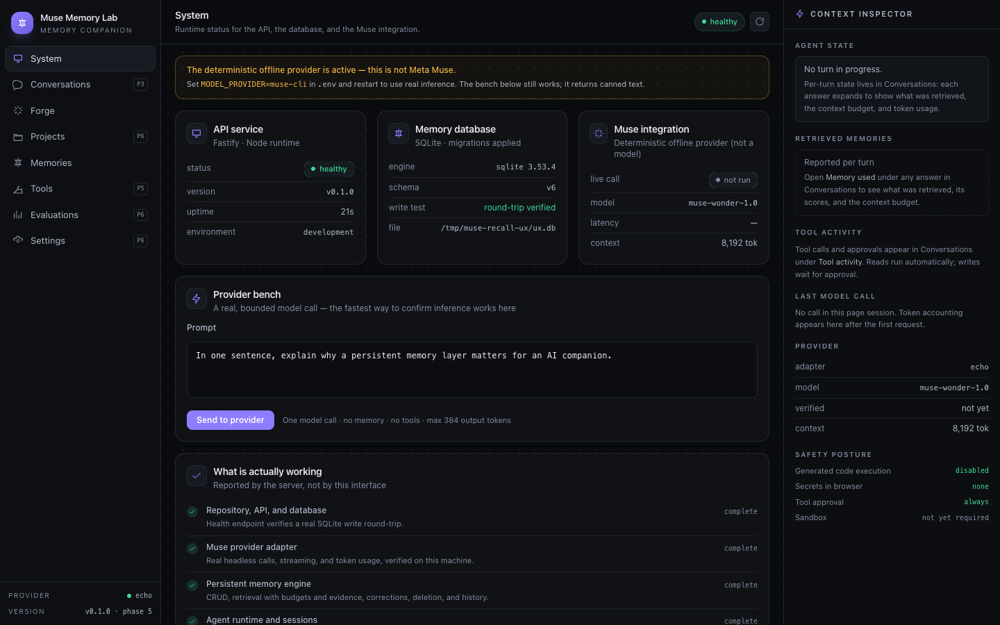
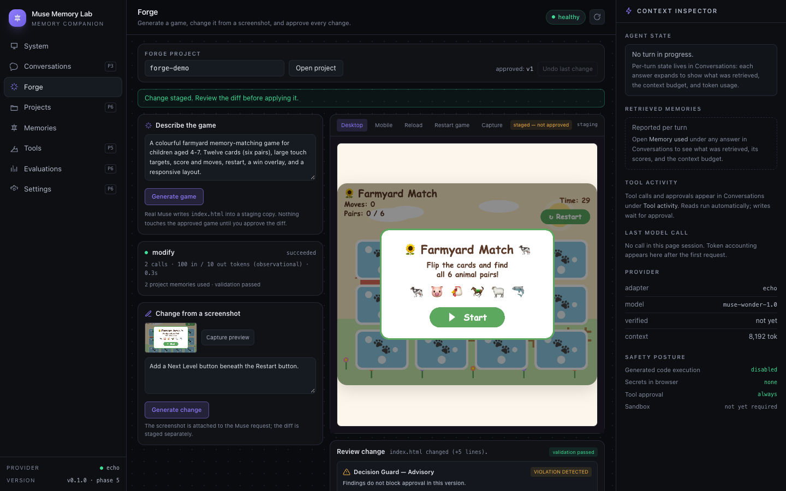

# Muse Recall — baseline UX audit

**Baseline:** `main` at `e6e2f86928f35565ccfb54ea8d33e1af1177bd6e` — the last approved
public-release candidate, before the product-positioning pass.
**Candidate:** `agent/muse-recall-product-positioning`.
**Method:** source inspection, then Playwright/Chrome against a seeded `forge-demo` project using
the deterministic offline provider. Screenshots at **1920×1080**, **1440×900** and **1280×720**.
No paid inference was triggered. The staged state used the repository's fake-Muse transport and
recorded fixtures; validation, runtime verification, approval and rollback were the production
paths.

**Baseline evidence:** [`ux-evidence/baseline/`](ux-evidence/baseline/) (10 frames).
**Final evidence:** [`ux-evidence/final/`](ux-evidence/final/) and
[`assets/ux-audit/after/`](assets/ux-audit/after/) (captured by `pnpm evidence:ux`).
**Full before/after narrative:** [UX_AUDIT.md](UX_AUDIT.md).
**Implemented system:** [DESIGN_SYSTEM.md](DESIGN_SYSTEM.md).

Severity: **P0** broken, misleading or inaccessible · **P1** major usability, clarity or hierarchy
· **P2** noticeable polish · **P3** optional.

---

## 1. What a first-time judge saw

The application opened on an internal **System** dashboard: API uptime, SQLite schema version, a
provider bench and a warning that the offline provider was active. The product name was **Muse
Memory Lab**, described as a *memory companion*. The working surface was **Forge**, described as
*"Generate a game, change it from a screenshot, and approve every change."* Five sidebar entries
(Projects P6, Tools P5, Evaluations P6, Settings P6) looked functional but opened phase
placeholders. The generated application — the actual product output — was a fixed **520 px**
iframe competing with a **312 px** generic Context Inspector for leftover width.

| Before — System landing (1440×900) | Before — Forge workspace (1440×900) |
| --- | --- |
|  |  |

At 1280×720 the same workspace cut the preview and pushed review controls below the fold. The
staged state was worse: approval appeared only after the full diff, below a 700 px preview and a
long code block.

---

## 2. Severity-ranked findings

### P0 — broken or misleading

| ID | Affected view | Problem | User impact | Correction |
| --- | --- | --- | --- | --- |
| P0-1 | Landing | The first screen was a System dashboard, not the product. The offline-provider warning preceded any application. | A judge cannot tell what the product does within five seconds; the first impression is an internal diagnostic console. | HTML Studio is the landing view; System is a secondary tab. See `ux-evidence/final/studio-approved-1440x900.png`. |
| P0-2 | Shell / Forge | Identity was **Muse Memory Lab / memory companion**; the workspace was **Forge — generate a game**. | The Muse Spark development capability read as a game demo attached to a memory prototype. | Product identity is **Muse Recall**; workspace is **HTML Studio — from prompt to working browser application**. Games remain one example. |
| P0-3 | Navigation | Projects, Tools, Evaluations and Settings were advertised as product surfaces with P5/P6 badges but only showed a placeholder. | The navigation read as an unfinished product and diluted the four working surfaces. | Navigation contains only HTML Studio, Memory, Conversations and System. |
| P0-4 | Review | At 1440×900 and 1280×720 the staged review, Guard and approval controls began below the viewport after a 520–700 px preview and the diff. | A reviewer could not see what they were approving, or approve it, without significant scrolling; the recorded demo lost the control moment. | Review is a dedicated right rail with the action block pinned; preview, source and diff are tabs. |

### P1 — major usability, clarity or hierarchy

| ID | Affected view | Problem | User impact | Correction |
| --- | --- | --- | --- | --- |
| P1-1 | Forge | Preview was fixed at 520 px; a generic Context Inspector consumed 312 px with mostly empty "no turn / no call" copy. | The generated application was not the visual centre; wide screens wasted space on non-product chrome. | Three purposeful columns (Development 280 / artifact fluid / Review 334); the inspector is removed; preview fills the height. |
| P1-2 | Forge | Project memory appeared only on the Memory screen; the job strip reduced it to "N project memories used". | The primary differentiator was invisible while prompting; a judge could not answer "what did Recall remember?" without leaving the workflow. | Project memory rail beside the prompt with active/superseded state, `used` marker, date and an explicit context-not-causation note. |
| P1-3 | Forge / Memory | Metadata and findings used 9–10 px text; memory labels and rule evidence were marginal at 1080p. | Recorded demos and normal reading become strenuous; important review evidence is easy to skip. | Body 13 px, metadata 10.5–11 px, primary labels 12–12.5 px, code 11.5 px with line numbers. |
| P1-4 | Forge | No source inspection after approval; diff text existed only while a job was staged. | A developer cannot audit the current artifact or copy it out; the "HTML artifact" never becomes tangible. | Preview / Source / Changes tabs; read-only artifact endpoint with line/byte counts, SHA-256 and title; copy and disclosed download. |
| P1-5 | Forge | Modification required **Capture preview** before "Generate change" enabled. | Non-canvas applications could not be modified; every text change was gated behind a visual step. | Screenshot is optional ("Reference the current preview — optional"); the server accepts text-only changes and only mentions an attachment when present. |
| P1-6 | Review | Decision Guard was 9–10 px inside the diff card, after a `<pre>` block and beside approve. | The advisory review mechanism read as decoration; its evidence was effectively unreadable. | Guard lives in the Review rail; assessment and findings first, with a collapsible scope/evidence-limits block; still explicitly advisory. |
| P1-7 | Forge header | Active version was a small "approved: v1" string; rollback was a small "Undo last change" control. | It was hard to tell what was current, what was proposed, and what undo would restore. | Version chips, approved/staged preview toggle, version history with current marker, two-step confirmation naming the recorded parent. |

### P2 — noticeable polish

| ID | Problem | Correction |
| --- | --- | --- |
| P2-1 | Inconsistent panel radii, button borders and ad-hoc type sizes. | Tokenised palette, panel/button/field/chip/tab recipes in `index.css`, documented in the design system. |
| P2-2 | Empty states were prose-only and sometimes contradictory ("Generate a game" in a general HTML tool). | Empty states state the next action; prompt examples show memory game, focus timer, expense tracker and recipe book. |
| P2-3 | No preview loading or failure affordance; a failed preview was a blank rectangle. | Loading overlay, runtime-error banner with reload, approval disabled while the preview fails, validation issues listed. |
| P2-4 | Sparse review rail when idle. | Idle guard explainer and version history; intentional calm rather than filler. |
| P2-5 | Error state exposed a raw HTTP/proxy message and a possibly wrong port hint. | Friendly local-API recovery card with command, retry and collapsible technical detail. |

### P3 — optional

- Pixel-level before/after comparison in review.
- Collapsible development column on very wide screens.
- Visual-regression snapshots in CI.

---

## 3. States inspected

Initial workspace · seeded project loaded · preview · source · staged diff · memory list · memory
detail with supersession · retrieval explanation · Decision Guard finding · clean Guard pass ·
approve · reject · rollback confirmation · rolled back · offline error · 1920/1440/1280.

The baseline could not reach source, approved-vs-staged toggle, or an independent Guard rail
because those surfaces did not exist; that absence is recorded above rather than simulated.

---

## 4. Corrections verified

| Claim | Evidence |
| --- | --- |
| HTML Studio is the landing surface with the application in the centre | `studio-approved-{1920,1440,1280}.png` |
| Source and diff are inspectable | `studio-source-*`, `studio-diff-*` |
| Review actions stay visible at 1280×720 | `studio-staged-1280x720.png` |
| Guard findings are readable and advisory | `studio-staged-1440x900.png`, `studio-staged-clean-1440x900.png` |
| Memory is visible beside development, with context-not-causation copy | `studio-approved-1440x900.png`, `memory-*` |
| Approval, reject and rollback are distinct and confirmed | `studio-approved-v2-*`, `studio-rejected-*`, `studio-rollback-confirm-*`, `studio-rolled-back-*` |
| Offline recovery is honest and usable | `error-offline-1440x900.png` |
| All three target viewports are free of page-level horizontal overflow | final frame set; see [UX_PRODUCT_POLISH_REPORT.md](UX_PRODUCT_POLISH_REPORT.md#7-visual-qa) |

Protected material was not touched: the demonstration video, Phase 15B trial data, experimental
evidence, Muse model configuration and the inference provider are unchanged.
