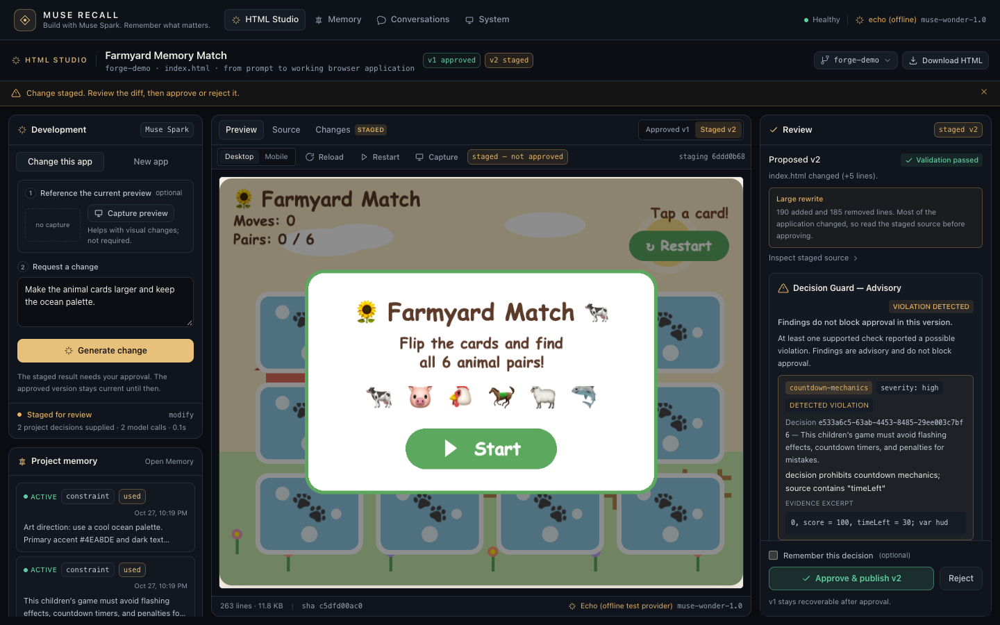
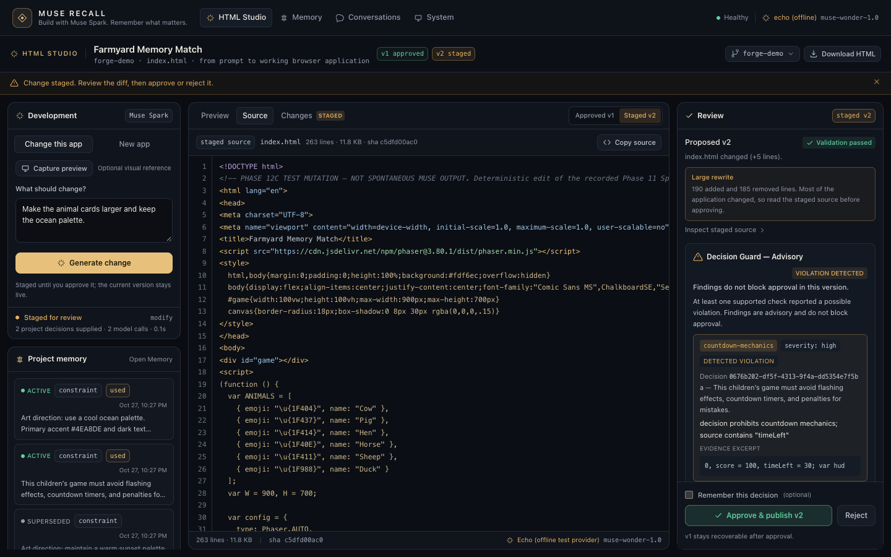
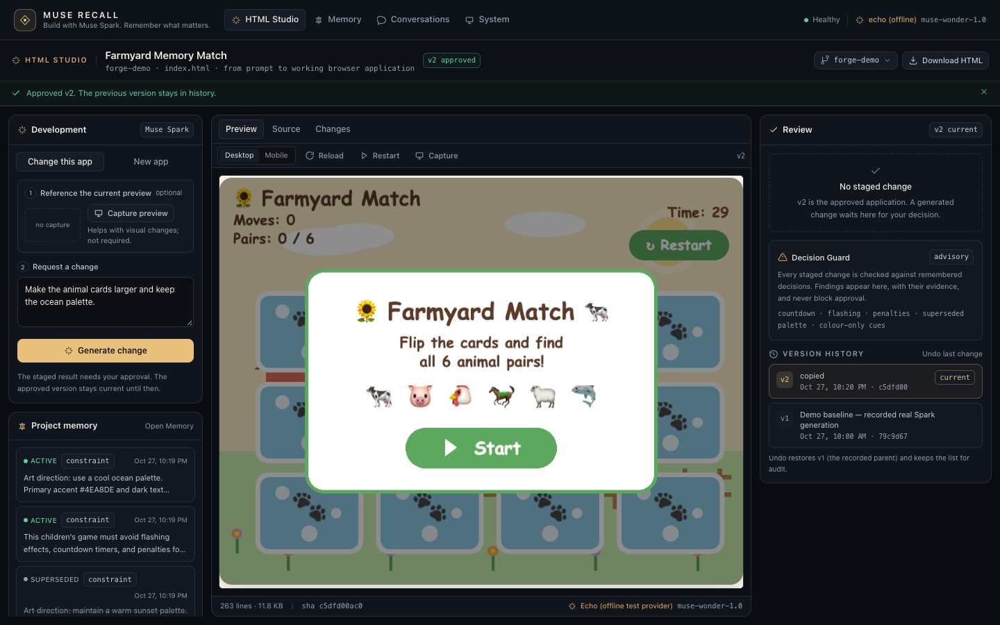
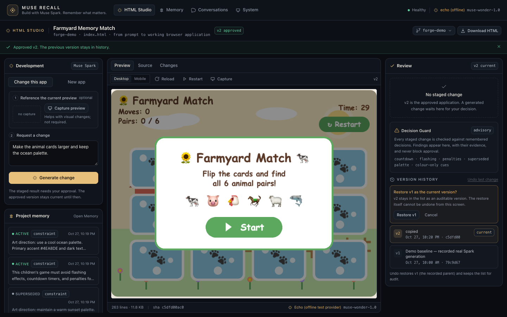

# Muse Recall — UX and product positioning report

**Working branch:** `agent/muse-recall-product-positioning`
**Implementation commit:** `1413c398068e5e359f5b42733f822802a42ba8b5`
**Report/evidence commit:** the final docs commit on this branch (see `git log -1 -- docs/UX_PRODUCT_POLISH_REPORT.md`).
**Baseline:** `main` at `e6e2f86928f35565ccfb54ea8d33e1af1177bd6e` (last approved public release).
**Merge status:** **not merged into `main`**. Director approval requested.

---

## 1. What changed, in one paragraph

Muse Recall no longer presents itself as a memory companion with a game generator attached. It
presents **Meta Muse Spark building working HTML applications**, with **persistent project memory**
as the differentiator and **human review** as the control. The landing surface is **HTML Studio**;
the generated application occupies the centre column; development sits left; memory, Decision
Guard, approval, rejection and rollback sit right. The backend was generalised from Phaser-only
games to general single-file HTML applications, so the positioning is supported by the
implementation. The change is a presentation and workflow pass over the existing architecture — no
second generation pipeline, no model-configuration change, no history rewrite.

---

## 2. Initial UX problems

Full evidence, severity ranking and screenshots: [UX_AUDIT.md](UX_AUDIT.md) and the
evidence-first [UX_BASELINE_AUDIT.md](UX_BASELINE_AUDIT.md).

### P0 — broken or misleading

1. **The landing surface was an internal System dashboard.** API uptime, SQLite version and a
   provider checklist opened the product. Screenshot: `assets/ux-audit/before/01-overview-*.png`.
2. **The identity was "Muse Memory Lab / memory companion", and the workspace was "Forge — generate
   a game".** The Muse Spark development capability read as a game demo.
3. **"HTML applications" was not supported.** Source audit: validation required Phaser and a
   canvas; the prompt said "Create a playable browser game"; runtime verification required a
   canvas. General applications could not pass.
4. **The navigation advertised non-functional surfaces** (Projects P6, Tools P5, Evaluations P6,
   Settings P6) as if they worked.

### P1 — major usability or presentation

- The generated app was boxed into a fixed 520 px iframe while a generic 312 px context inspector
  competed for space; at 1280×720 the preview and review area fell below the fold.
- Project memory was invisible while writing a prompt; it lived on a separate screen.
- Decision Guard was 9–10 px text below a `<pre>` diff, with approval in the same dense card.
- Rollback was a small top-right "Undo last change"; the active version was hard to identify.
- No source view after approval.
- Iteration required a screenshot capture before the change request could be sent.
- Typography used 9–10 px metadata throughout.
- First run had no explanation, examples or next action.

### P2/P3

Inconsistent component recipes and spacing; superseded decisions struck through; sparse review
rail when idle; mobile secondary; no large-rewrite warning. See the audit.

---

## 3. Implemented changes

### 3.1 Shell and identity

- Product name **Muse Recall**, tagline **"Build with Muse Spark. Remember what matters."**
- Four working surfaces only: **HTML Studio**, **Memory**, **Conversations**, **System**.
- HTML Studio is the default view; System is secondary diagnostics.
- Top bar carries the product identity, nav, health and the configured provider; the provider is
  labelled "echo (offline)" when the deterministic provider is active, never as live Muse. The
  Development header repeats the configured engine label, so the workflow never claims a live
  Muse Spark run while the echo provider is active.
- Phase badges and unbuilt sections removed from navigation; the roadmap remains in docs.

### 3.2 HTML Studio workspace

- Three-purpose layout at ≥1280 px: Development (280 px), artifact (`minmax(0,1fr)`), Review
  (334 px). The generic context inspector is gone.
- Artifact tabs: **Preview**, **Source**, **Changes**.
  - Preview: sandboxed iframe, fills the column, desktop/mobile width, reload/restart/capture,
    approved-vs-staged toggle, explicit "staged — not approved" chip.
  - Source: line numbers, a small HTML tokenizer, byte/line count and SHA-256, copy.
  - Changes: add/remove diff, hunk headers, wrap toggle, jump-to-additions, copy.
- Review rail: validation, large-rewrite warning, Decision Guard, provenance, version history,
  sticky approval/rejection, two-step rollback confirmation.
- Project switcher lists projects and can open/create a project id; Escape closes it.
- Recent activity lists generation attempts, including failed/rejected work (truthful history).
- Artifact footer shows lines, bytes, source SHA and the model/provider in use.

### 3.3 HTML output improvements

- **General HTML support:** validation now accepts a document body with visible text or a
  renderable element; Phaser documents still require canvas/`Phaser.Game`; empty shells fail.
- **Runtime verification:** accepts visible rendered content or a canvas; still fails page/console
  errors, blank renders and blocked network requests; HTTP/WebSocket exfiltration remains blocked.
- **Prompt:** application-first; single `index.html`, inline CSS/JS, no build step, approved CDN
  only; Phaser contract retained for game requests.
- **Optional screenshot:** modification works from text alone; a capture is a visual aid.
- **Artifact endpoint:** `GET /api/forge/projects/:id/artifact[?job=…]` returns approved or staged
  source as data with line/byte counts, SHA-256, title and version. It is read-only and is never
  rendered in the application origin.
- **Export:** "Download HTML" saves the inspected artifact client-side. The UI states that a CDN
  reference still needs network and does not claim the file is self-contained.

### 3.4 Memory UX

- Project memory rail beside the prompt: active/superseded status, type, content, updated time,
  and a `used` marker for decisions supplied to the current job.
- Footer distinguishes context from causation: "Retrieved context, not proof that it changed a
  model decision."
- "Open Memory" opens the full inspector; card clicks open the decision detail.
- The Memory screen remains the place for provenance, correction history and retrieval explanation.
- Job strip reports the number of decisions supplied and the provider usage without inventing
  progress.

### 3.5 Decision Guard UX

- Lives in the Review rail, beside approval, never as a gate.
- Keeps the advisory banner, assessment reason, findings (rule, severity, decision reference,
  explanation, bounded evidence excerpt) and a collapsible scope/engine-metadata block.
- "Findings do not block approval in this version" is always present; no green PASS badge.
- The scroll container was removed so findings are readable in the rail rather than trapped in a
  nested 248 px pane (visible in the final evidence).

### 3.6 Human control

- State vocabulary matches implementation: staged, approved/current, rejected, rolled back,
  failed.
- Approve is a distinct action; generation never implies approval.
- Rollback uses the **recorded parent** (`base_version` ancestry), not `current − 1`; the label and
  confirmation name the exact version. This mirrors the server's `rollbackTarget`.
- The next proposed version is `max(existing versions) + 1`, correct after rollbacks and
  non-linear history.
- Version history shows current and prior versions with timestamp and short SHA.

### 3.7 Files changed (summary)

| Area | Files |
| --- | --- |
| Shell and navigation | `apps/web/src/App.tsx`, `components/TopBar.tsx`, `views.ts`, `index.html` |
| Design tokens and primitives | `apps/web/src/index.css`, `components/Icon.tsx` |
| HTML Studio | `components/studio/StudioView.tsx`, `PromptPanel.tsx`, `ReviewPanel.tsx`, `SourceAndDiff.tsx`, `StudioMemory.tsx`, `StudioActivity.tsx`, `ProjectSwitcher.tsx` |
| Memory and Guard presentation | `components/memory/MemoryInspector.tsx`, `components/forge/DecisionGuardAdvisory.tsx` |
| Diagnostics | `components/Overview.tsx`, `components/ProviderBench.tsx` |
| Client API and formatting | `lib/api.ts`, `lib/format.ts` |
| Server contract | `packages/shared/src/forge.ts`, `apps/server/src/routes/forge.ts`, `forge/prompt.ts`, `forge/runner.ts`, `forge/runtime-check.ts`, `forge/workspace.ts`, `apps/server/src/index.ts` |
| Tests and fixtures | `tests/integration/forge-api.test.ts`, `tests/unit/forge-{prompt,workspace}.test.ts`, `tests/fixtures/general-app.html`, `tests/fixtures/forge-prompt/*` |
| Evidence tooling | `scripts/ux-evidence.ts`, `package.json` (`evidence:ux`), `scripts/verify-ui.ts` |
| Documentation | this report, `UX_AUDIT.md`, `UX_BASELINE_AUDIT.md`, `DESIGN_SYSTEM.md`, `HTML_STUDIO_ASSESSMENT.md`, `PRODUCT_POSITIONING.md`, `ux-evidence/README.md`, README and submission copy |

Removed: the old `ForgeView`, `Sidebar` and `ContextInspector` (replaced by HTML Studio, the top
bar, and the purpose-built review rail). No experimental evidence, video, model configuration or
inference-provider file was changed.

---

## 4. Before / after

| Before (1440×900) | After (1440×900) |
| --- | --- |
|  |  |

| Before (1280×720) | After (1280×720) |
| --- | --- |
|  |  |

Staged review, source and control states:

A second full-resolution evidence set, including 1920 staged/source and an offline-error state, is
in `docs/ux-evidence/final/`. Baseline frames are in `docs/ux-evidence/baseline/`.

---

## 5. Accessibility results

| Check | Result |
| --- | --- |
| Contrast | ink 15.9:1, ink-dim 11.3:1, muted 6.7:1, accent 10.8:1, ok 9.6:1, warn 9.6:1, err 7.2:1 on surface; accent-ink on accent 10.7:1. WCAG AA for all normal text, AAA for primary text. |
| Focus | 2 px `:focus-visible` ring, 2 px offset; measured `solid 2px` on every tab stop. |
| Keyboard | Native buttons throughout; Preview/Source/Changes support Left/Right arrow roving focus; Escape closes the project dialog; no keyboard traps. |
| Names | Every button has an accessible name (verified by enumerating the DOM); inputs have labels or `aria-label`; iframe titled "HTML application preview". |
| Semantics | One `h1` per surface; Studio's artifact panel is a `section`, not a nested `main`; nav uses `aria-current="page"`; tabs use `role="tab"`/`aria-selected`/`aria-controls`. |
| Status messaging | Generation strip is live; notices/errors use `role="status"`/`role="alert"`; no invented progress percentages. |
| Reduced motion | With `prefers-reduced-motion: reduce`, skeleton and spinner animation durations measured at `1e-06s`; transitions disabled. |
| Refocus | Project switching clears prior state before fetch, removing a transient preview 404 and stale title. |

Known gaps: the iframe focus ring is browser-native (styled focus applies to the application
chrome, not the generated document). The mode switch now exposes a proper tablist with an
associated tabpanel.

---

## 6. Functional test results

Commands run from the candidate worktree:

| Check | Result |
| --- | --- |
| `pnpm verify` (lint + typecheck + 491 tests) | **PASS** — 491 passed, 3 skipped (494 total), 30 files. |
| `pnpm build` | **PASS** — web 478.4 kB JS / 43.1 kB CSS; server 306.6 kB bundle. |
| `pnpm verify:runtime` | **PASS** — valid scene; broken scene fails; HTTP and WebSocket exfiltration blocked. |
| `pnpm verify:forge` | **PASS** — 9 checks: generate, preview canvas, approve, screenshot, staged diff, reject, approve v2, rollback v1, no console/page errors. |
| `pnpm verify:browser` (`scripts/verify-ui.ts`, echo mode) | **PASS** — System, provider bench, memory create/correct/explain/delete, two conversation turns, Studio tabs; live-Muse and generative-UI segments are explicitly skipped when the echo provider is configured. |
| `pnpm evidence:ux` (`scripts/ux-evidence.ts`) | **PASS** — 24 frames across three viewports; staging, Guard finding, reject, text-only modify, approve with a decision, download, rollback confirmation, rollback and offline error; assertions on `current_version` 1 → 2 → 1. |
| Text-only modify (UI + API) | **PASS** — change staged without a screenshot; approved v2; rolled back v1. |
| Reject (UI) | **PASS** — "Change rejected. The approved application is untouched."; current remains v1. |
| Export | **PASS** — downloaded `farmyard-memory-match-v1.html` (11,529 bytes); opened independently from `file://`, rendered a canvas with no page errors. CDN dependency is disclosed. |
| Artifact endpoint | **PASS** — staged and approved source with SHA-256, line/byte counts, title/version; integration tests. |
| General HTML application | **PASS** — fixture validated, previewed, approved; runtime `{ok:true, rendered:true, canvas:false}`. |
| Empty document | **FAIL as intended** — runtime `{ok:false, rendered:false}` with "did not render visible content". |

The browser smoke script previously asserted the old landing page, a live Muse probe and an
unbuilt-section placeholder. It now starts on System, skips the live probe and generative-interface
journey under the echo provider, and checks the Studio tabs. Historical screenshots are restored
from HEAD after an earlier smoke run overwrote them.

---

## 7. Visual QA

Captured at **1920×1080**, **1440×900** and **1280×720** against the seeded demo.

| Check | Result |
| --- | --- |
| Preview fully visible at 1280×720 | Yes; review rail and version footer visible; no page-level scroll. |
| No clipped text in primary controls | Yes; long summaries wrap, code panes scroll. |
| Code readability | Source 11.5 px mono with line numbers; diff tinted with +/− and wrap toggle. |
| Panel alignment | 280 / fluid / 334 grid consistent at all three widths; 12 px gaps. |
| Contrast | See §5; all body/meta text ≥6.2:1. |
| Responsive | <1280 stacks Development → Artifact → Review; prompt/memory scroll independently. |
| Empty state | Prompt examples, "No HTML application yet", review/memory empty states, no console errors after the project-switch fix. |
| Staged state | Preview shows "staged — not approved"; approval visible; guard finding readable in rail. |
| Loading | Skeletons for project/artifact; spinner with text for generation; no layout shift. |
| Errors | Inline error bars; runtime-error banner with Reload; validation issues listed. |

### 7.1 Iteration passes

**Pass 1 (first implementation, 1440 and 1280).** Defects found in the captured frames, not in
tests:

- the review rail grew with content, so **Approve/Reject were clipped at 720 px**;
- the Guard's scope paragraph pushed findings below the fold, showing a block of caveats before
  any finding;
- the memory rail overflowed the left column and hid its own footer;
- the optional screenshot block consumed ~110 px after screenshots became optional;
- the diff opened on ~185 removals before showing additions;
- the offline card exposed a raw HTTP/proxy string and a hard-coded port hint;
- the project picker's menu overlapped the review rail without a visible close affordance;
- long system paths were truncated mid-directory.

**Corrections.** Fixed review footer + scrolling evidence pane; findings before the collapsible
scope block; capped, scrollable memory list with the caveat always visible; compact optional
capture row; additions-first diff with wrap and counts; friendly offline recovery card; Escape and
focus return for the project dialog; separator-aware path shortening.

**Pass 2 (final implementation).** All 24 final frames were re-captured by `pnpm evidence:ux`.
Approve/Reject are visible at 1280×720; the Guard rule and severity are visible in the same
viewport; the approved/staged toggle, source and changes tabs align; the memory caveat and "Open
memory" link are visible at 1440×900; no page-level horizontal overflow occurs at any target
viewport. Remaining known gaps are listed in §8.

All five commands above were re-run during the final QA pass on this branch. The browser smoke script writes its screenshots under `test-results/verify-ui/` (gitignored)
by default, so a routine verification run cannot overwrite the historical Phase 1/9 frames.
`docs/ux-evidence/` is produced only by `pnpm evidence:ux`.

---

## 8. Remaining limitations

1. **Decision Guard is advisory only.** It checks five supported source-pattern families, never
   blocks approval, and is not compliance verification. The accuracy audit is the reason it stays
   advisory.
2. **Runtime verification is load-time only.** It checks page/console errors, blocked network
   requests, blank render and (for Phaser) canvas creation. It does not click through the app,
   inspect pixels, or prove later interactions.
3. **General HTML support is deliberately narrow.** One self-contained `index.html`, no build
   step, inline CSS/JS, no network beyond the approved CDN. Not a framework/package environment.
4. **Export is not a verified self-contained bundle.** A CDN reference still needs network; the UI
   says so.
5. **Memory shows four decisions in the rail.** The inspector has the full list; active and
   superseded are labelled but the slice is combined.
6. **Conversations and generative UI remain supporting surfaces.** They were not part of the
   repositioning narrative and were not redesigned.
7. **Mobile is secondary.** Desktop 1280–1920 is the target; tablet stacks acceptably.
8. **The offline provider is visible in screenshots.** It is labelled "echo (offline)" and "not a
   model"; it must not be presented as live Muse in a submission recording.
9. **No visual-regression snapshot suite.** Evidence is captured by scripts, not diffed in CI.
10. **One unplanned live Muse modification** was invoked during an intermediate QA capture before
    the runner was pinned to `fake-muse` (7 calls, 47 s, no diff retained). It is not represented
    in the retained evidence or the demo; all retained review evidence uses the recorded fixture.
    This is a process note, not a product claim.

---

## 9. Demo impact

The protected MP4 was **not modified, re-rendered, or overwritten**. It was read with `ffprobe`
and sampled frames only.

**Comparison:** the existing cut (1920×1080, 172 s) is a competent edit, but it shows
"Muse Memory Lab / memory companion", "Forge", a game-studio description, five non-functional nav
items, and a preview competing with a generic inspector. The revised UI changes the product name,
category, preview prominence, memory visibility and approval layout in every frame.

**Recommendation:** re-record a V2 **only after director approval**, using
`REVISED_DEMO_STORYBOARD.md`. Keep the existing cut as the
approved fallback. Preserve the mandatory replay overlays and the Phase 12A provenance
distinctions. Do not present replayed output as live generation.

---

## 10. Protected artifacts and constraints

| Constraint | Status |
| --- | --- |
| Phase 15B branch/worktree/processes | **Untouched.** Independent worktree `muse-memory-lab` on `agent/phase15b`; no edits, no process interference, no merge. |
| Muse model configuration | **Unchanged.** No `.env` or provider/model config committed or edited for the product change. |
| Existing demonstration video | **Untouched.** Read-only inspection only. |
| Historical evidence | **Preserved.** Test fixtures regenerated only where the production prompt changed; recorded outputs and Phase 11–14 evidence are not rewritten. Historical screenshots overwritten by a smoke run were restored from HEAD. |
| Git history | **Preserved.** No force-push, rebase, squash, or branch deletion. |
| `main` | **Unchanged.** No merge performed. |
| Security posture | **Preserved.** Sandboxed iframe (no `allow-same-origin`), CSP `sandbox allow-scripts`, request allowlist, WebSocket blocking, escaped source rendering, no `dangerouslySetInnerHTML`, no browser API keys. |

---

## 11. Merge recommendation

**Request director review of `agent/muse-recall-product-positioning`; do not merge to `main` yet.**

Reasons to accept:

- The product identity and workflow now match what the implementation actually does.
- HTML application support is real, tested and documented, not a label on a game pipeline.
- The artifact is the visual centre; memory and guard are visible in the development loop.
- Approval, rejection, rollback and version ancestry remain intact and are clearer.
- All automated checks and browser verification pass; the security posture is unchanged.

Conditions before public release:

1. Re-record the demo (or explicitly accept the existing footage as a fallback) and keep provenance
   labels.
2. Run the submission copy past the evidence map one more time; re-count the 93/289 words.
3. Confirm the live provider and System live check in the recording environment; do not record with
   the echo provider.
4. Have the director approve the new positioning and the test-count/API documentation updates.

**No merge, tag, release or submission has been performed.**

---

## 10. Merge recommendation

**Recommendation: merge `agent/muse-recall-product-positioning` into `main` after director review
of the demo implication; do not merge automatically.** The branch is self-contained, `pnpm verify`
and `pnpm build` pass, the application still uses the existing Muse provider configuration and
approval/rollback server paths, and no experimental evidence or video was modified.

**Do not merge** if the approved submission cut must remain byte-for-byte identical to the
repository it was recorded from: this branch changes the product name, landing surface, layout and
every visible frame. The existing cut remains the safe fallback; the revised storyboard is the
path for a V2 recording.

The branch is not merged, not force-pushed, and the submission has not been made.

---

## 11. Evidence index

| Artefact | Location |
| --- | --- |
| Baseline audit (severity-ranked, screenshots) | [UX_BASELINE_AUDIT.md](UX_BASELINE_AUDIT.md) |
| Full before/after audit | [UX_AUDIT.md](UX_AUDIT.md) |
| Implemented design system | [DESIGN_SYSTEM.md](DESIGN_SYSTEM.md) |
| HTML Studio capability assessment | [HTML_STUDIO_ASSESSMENT.md](HTML_STUDIO_ASSESSMENT.md) |
| Product positioning | [PRODUCT_POSITIONING.md](PRODUCT_POSITIONING.md) |
| Before/after frames, three viewports | [ux-evidence/README.md](ux-evidence/README.md) |
| Capture script | `pnpm evidence:ux` (`scripts/ux-evidence.ts`) |
| Audit comparison set | [assets/ux-audit/](assets/ux-audit/) |
| Revised storyboard (not recorded) | `submission/REVISED_DEMO_STORYBOARD.md` |
