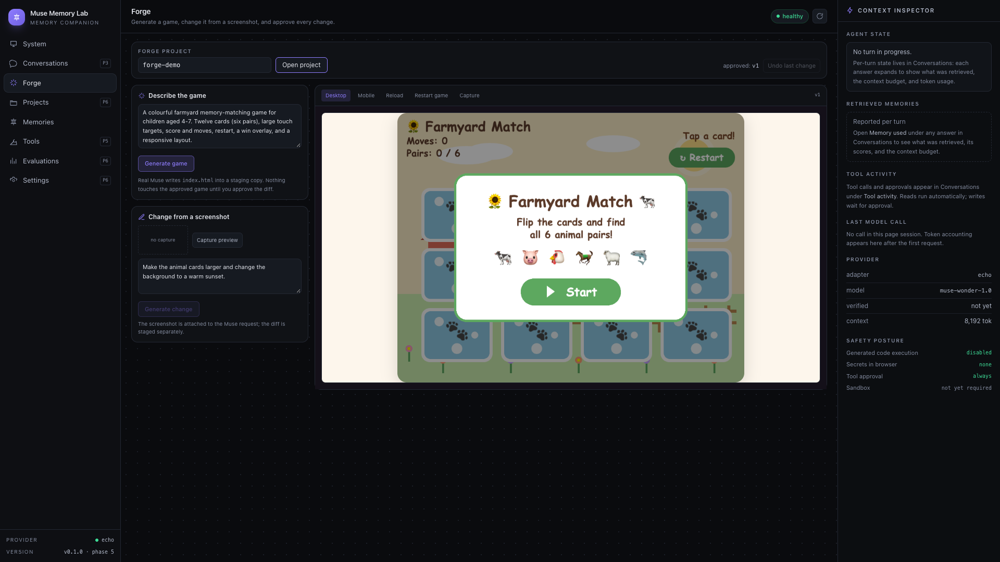
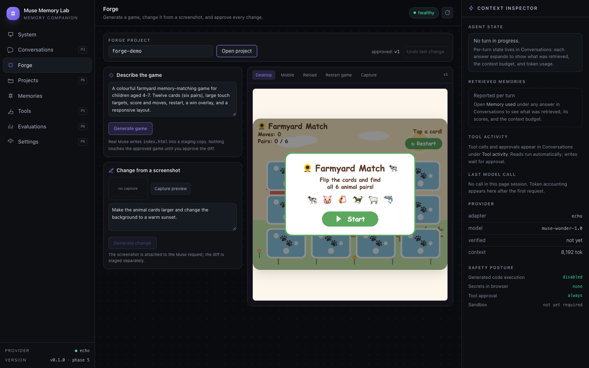
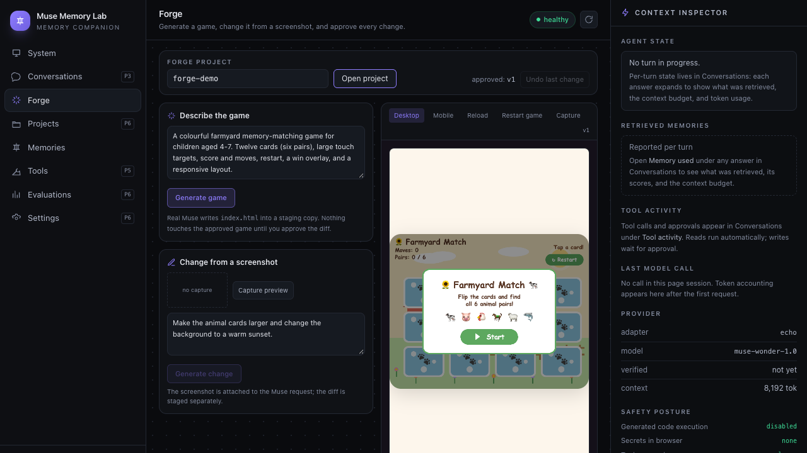
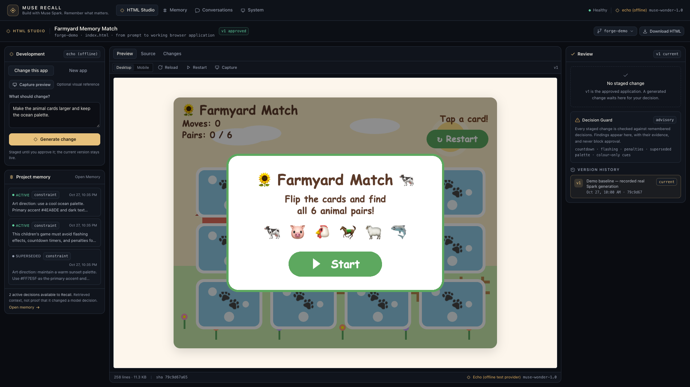
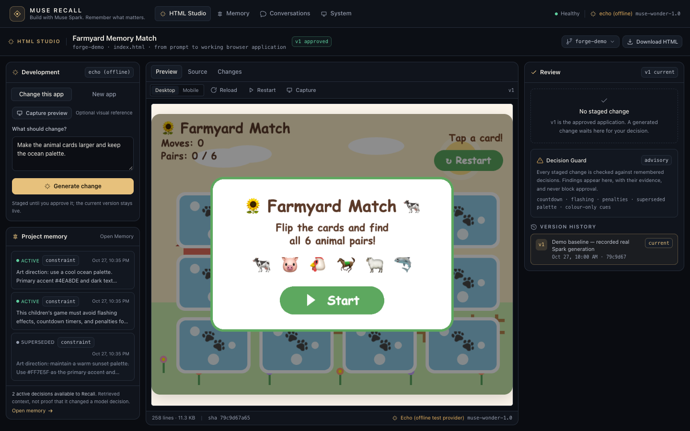
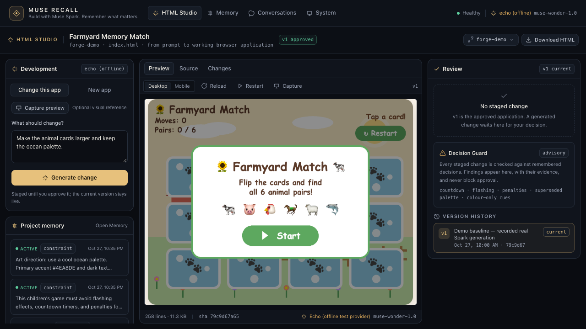

# UX evidence — Muse Recall

This directory holds the before/after visual evidence for the product-positioning and UX pass on
`agent/muse-recall-product-positioning`. It is separate from the recorded Phase 11–15 experimental
evidence and does not replace it.

## How the frames were produced

| Set | How |
| --- | --- |
| `baseline/` | Captured from `main` at `e6e2f86` before implementation: 10 frames (Studio, Memory, System at 1920×1080 / 1440×900 / 1280×720, plus the 1440 staged review). |
| `final/` | Captured by `pnpm evidence:ux` (`scripts/ux-evidence.ts`): the real Fastify API and Vite client against a freshly seeded `forge-demo` project, Chrome/Playwright at the three target viewports. |
| `../assets/ux-audit/before/`, `../assets/ux-audit/after/` | The audit's original comparison set, including a narrower set of staged/source/review states. |

`pnpm evidence:ux` also exercises the production paths for staging, the Decision Guard, reject,
text-only modify, approve with a project decision, download, rollback confirmation and rollback,
and the offline state. It fails on page errors, missing findings, a version mismatch or an
unexpected export.

## Frames

### Before — baseline `main`

| View | 1920×1080 | 1440×900 | 1280×720 |
| --- | --- | --- | --- |
| Forge workspace | `baseline/studio-1920.png` | `baseline/studio-1440.png` | `baseline/studio-1280.png` |
| Memory | `baseline/memory-1920.png` | `baseline/memory-1440.png` | `baseline/memory-1280.png` |
| System landing | `baseline/system-1920.png` | `baseline/system-1440.png` | `baseline/system-1280.png` |
| Staged review (1440 only) | — | `baseline/staged-review-1440.png` | — |

Baseline limits: the preview had no source or staged/approved toggle, so those states have no
before frame.

### After — HTML Studio

| View | 1920×1080 | 1440×900 | 1280×720 |
| --- | --- | --- | --- |
| Approved application | `final/studio-approved-1920x1080.png` | `final/studio-approved-1440x900.png` | `final/studio-approved-1280x720.png` |
| Source inspection | `final/studio-source-1920x1080.png` | `final/studio-source-1440x900.png` | `final/studio-source-1280x720.png` |
| Staged review | `final/studio-staged-1920x1080.png` | `final/studio-staged-1440x900.png` | `final/studio-staged-1280x720.png` |
| Memory | `final/memory-1920x1080.png` | `final/memory-1440x900.png` | `final/memory-1280x720.png` |
| System | `final/system-1920x1080.png` | `final/system-1440x900.png` | `final/system-1280x720.png` |

Additional states at 1440×900:

- `final/studio-diff-1440x900.png` — large rewrite, additions-first diff
- `final/studio-rejected-1440x900.png` — rejected change, approved version untouched
- `final/studio-staged-clean-1440x900.png` — authentic small change, clean Guard pass
- `final/studio-approved-v2-1440x900.png` — approved second version
- `final/studio-rollback-confirm-1440x900.png` — two-step restore confirmation
- `final/studio-rolled-back-1440x900.png` — restored v1, history retained
- `final/memory-after-approval-1440x900.png` — new decision saved during approval
- `final/error-offline-1440x900.png` — local API unavailable

## Before / after comparison

| 1920×1080 | 1440×900 | 1280×720 |
| --- | --- | --- |
|  |  |  |
|  |  |  |

## Disclosures

- **Deterministic provider.** The screenshots were captured with `MODEL_PROVIDER=echo`, so the UI
  labels the provider "echo (offline)" / "Echo (offline test provider)". No model inference is
  implied. A live submission recording must configure `muse-cli` and verify the live check first.
- **Synthetic staged content.** Staged states use the repository's fake-Muse transport. The
  Decision Guard finding frame uses the recorded Phase 12C mutation
  (`docs/hackathon-evidence/phase12e/sources/A-violation-mutation.html`), which is explicitly
  labelled inside the document as a test mutation, not spontaneous Muse output. The clean pass
  uses the recorded authentic Phase 12 `C-v2.html`. These frames demonstrate UI behaviour; they
  are not new experimental evidence and must not be cited as such.
- **No experimental evidence changed.** Phase 11–15B data, the demonstration video and the
  original evidence directories are untouched. `pnpm evidence:ux` writes only here.
- **Rollback is real.** The script asserts `current_version` 1 → 2 → 1 through the API, not just
  the rendered message.
